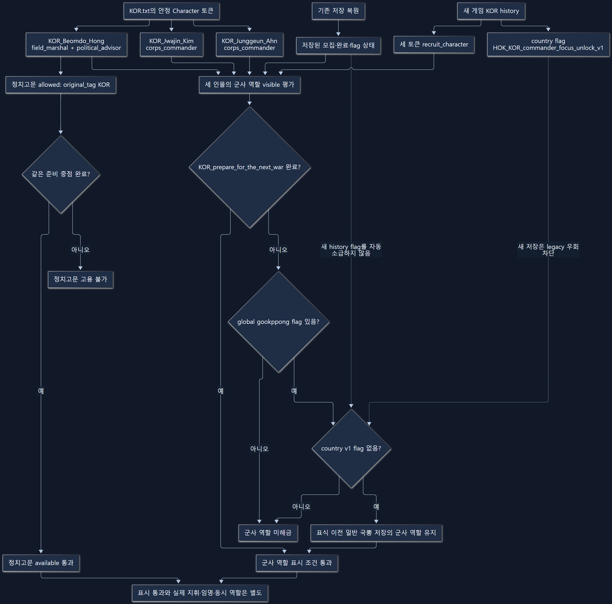
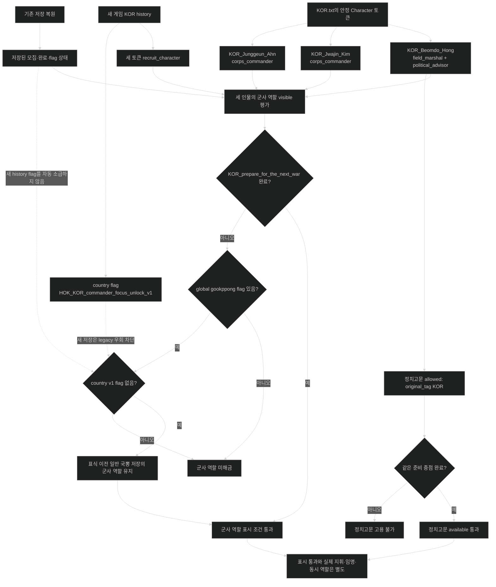

# 지휘관·고문 역할과 저장 guard

기준: **2026-11-20, Asia/Seoul**. 호환판 `feat/korean-focus-update-20260922@9a01955785bcdd827c9c85522537a0bfc57ed654` 위 현재 미커밋 작업 트리의 소스 설명이다. 이번은 문서·도표만 상세화하며 게임 코드는 유지한다.

[전체 목차](README.md) · [도메인](domain-model.md) · [상세화 기록](../implementation/2026-11-20-architecture-detail-expansion.md) · [유지 안내](maintenance.md)

이 페이지는 이미 반영된 11월14일 지휘관 해금 계층을 설명한다. 작업 전 읽을 정본은 [지휘관 통합·검증 기록](../implementation/2026-11-14-korean-commander-unlock-port.md)과 [선택 잠금](../../tools/hok_commander_unlock_lock.json)이다. 당시 소스 확인과 실제 RT56 UI·지휘·저장 미검증을 구분한다. 이번 문서 렌더링은 그 실행 검증을 대신하지 않는다.

## D19 · 모집된 인물의 역할·중점 해금·기존 저장 분기

실선은 정의·초기화 또는 조건 분기, 점선은 저장 범위의 경계다. 하나의 Character가 여러 역할을 갖는 것과 각 역할의 표시·고용 조건은 별개다. 아래는 군사 역할의 `visible`과 홍범도 정치고문의 `available`을 구분한 흐름이다.

Mermaid 편집 원본

## 실제 정의와 scope

| 항목 | 현재 정의 | 의미와 경계 |
|---|---|---|
| 초기 모집 | [KOR 이력](<../../history/countries/KOR - Korea.txt>)의 세 `recruit_character` | 역할 표시 조건이 참이라는 사실만으로 미모집 인물을 새로 만드는 효과가 발생하지 않는다. |
| 새 게임 버전 | 같은 이력의 `set_country_flag = HOK_KOR_commander_focus_unlock_v1` | KOR Country의 표식이다. 일반 국뽕 선택의 전역 표식과 같은 저장 범위가 아니다. |
| 일반 국뽕 legacy | [인물 정의](../../common/characters/KOR.txt)의 `has_global_flag = kor_hok_gookppong_enabled_flag`와 v1 부재 | 두 조건의 AND가 필요하다. v1이 있는 새 게임은 국뽕 설정만으로 군사 해금을 우회하지 않는다. |
| 세 군사 역할 | 홍범도 `field_marshal`, 김좌진·안중근 `corps_commander` | `focus 완료 OR (global 국뽕 AND country v1 없음)`을 각각의 `visible`에서 평가한다. 세 인물의 능력·trait·초상화·모집은 이 계층에서 변경하지 않는다. |
| 홍범도 정치고문 | 같은 인물의 `advisor` / `idea_token = beomdo_hong` | `allowed`의 original_tag KOR와 `available`의 준비 중점 조건을 유지한다. 군사 역할의 legacy 우회를 정치고문에 복제하지 않는다. |
| 구현 소유권 | [선택 생성 계층](../../tools/upstream_commanders.py), [독립 잠금](../../tools/hok_commander_unlock_lock.json) | 생성된 인물·이력 출력을 수동 수정해 도표와 맞추지 않는다. writer의 정확한 선조/최종 바이트 계약은 [개발 생성 구조](source-and-generation.md)를 따른다. |

## 처리 대장과 실제 확인의 경계

| 후보 | 처리 | 근거·남은 항목 |
|---|---|---|
| 축약됐던 D19 | **문서 수정** | 인물 정의·모집·새/기존 저장·군사 세 역할·정치고문을 실제 조건으로 나눴다. |
| 세 군사 역할의 visible·홍범도 고문 available | **의도적 유지** | 현재 코드의 조건을 설명한다. 자동 임명·역할 재생성·고용 비용 변경을 추가하지 않는다. |
| 기존 저장에 새 history flag 소급·과거 완료 상태 추정 | **제외** | 현재 계층은 해당 마이그레이션을 수행하지 않는다. |
| 실제 UI 해금·군사 지휘 유지·고문 동시 사용·새/기존 저장 왕복 | **미확인 또는 기존 기록 범위** | [지휘관 구현 기록](../implementation/2026-11-14-korean-commander-unlock-port.md)의 소스/소유 계약 결과와 실행 미검증을 구분한다. 이번은 게임을 실행하지 않았다. |

중점 조건·국뽕 flag scope·버전 guard·인물 역할이 바뀌면 D19와 위 정의를 함께 대조한다. 과학자·첩보원의 무작위 모집과 초상화 계층은 이 지휘관 guard와 별개이며, 그 영역을 바꾸거나 검토할 때는 AGENTS의 각각의 통합 기록을 먼저 읽는다.
