# 콘텐츠 호출·진행·배치와 기능별 시퀀스

기준: **2026-11-20, Asia/Seoul**. `feat/korean-focus-update-20260922@9a01955785bcdd827c9c85522537a0bfc57ed654` 위 현재 미커밋 작업 트리의 소스 설명이다. 이번은 문서·도표만 상세화하며 게임 코드·설정·검증 결과를 바꾸지 않는다.

[전체 목차](README.md) · [도메인과 scope](domain-model.md) · [산둥 사례](shandong-government.md) · [상세화 기록](../implementation/2026-11-20-architecture-detail-expansion.md) · [유지 안내](maintenance.md)

호출, 조건 조회, 진행 선행, 배치 기준은 서로 다른 관계다. 아래 도표는 주요 공용 경로와 실제 대표 기능을 상세히 연결한다. 전체 중점의 좌표·분기는 [좌표 명세](../HOK_KOREAN_FOCUS_LAYOUT_COORDINATES.md)와 각 정의를 정본으로 삼는다.

## D05 · 진입점에서 조건·효과·데이터까지

실선은 표시한 효과 호출·상태 변경, 점선은 조건 또는 ID 조회다. subgraph는 서로 다른 기능군이며 한 번의 실행에서 모두 호출된다는 뜻이 아니다.

[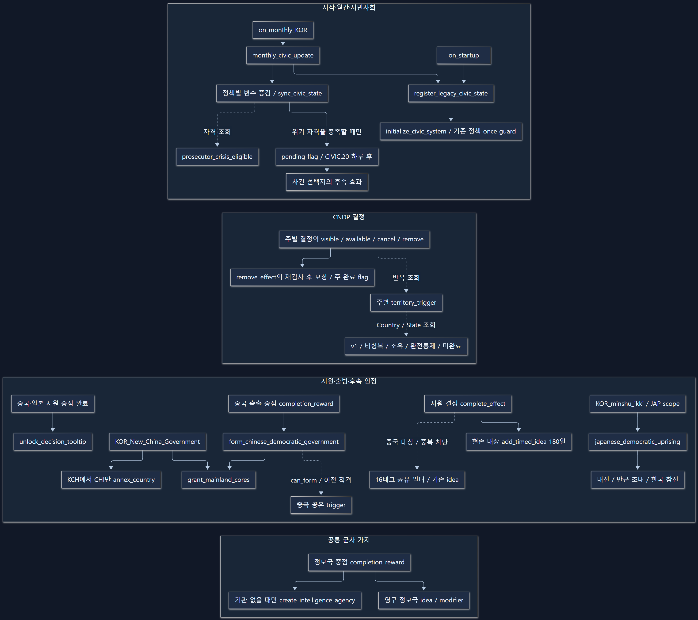](images/D05.dark.svg)

Mermaid 편집 원본

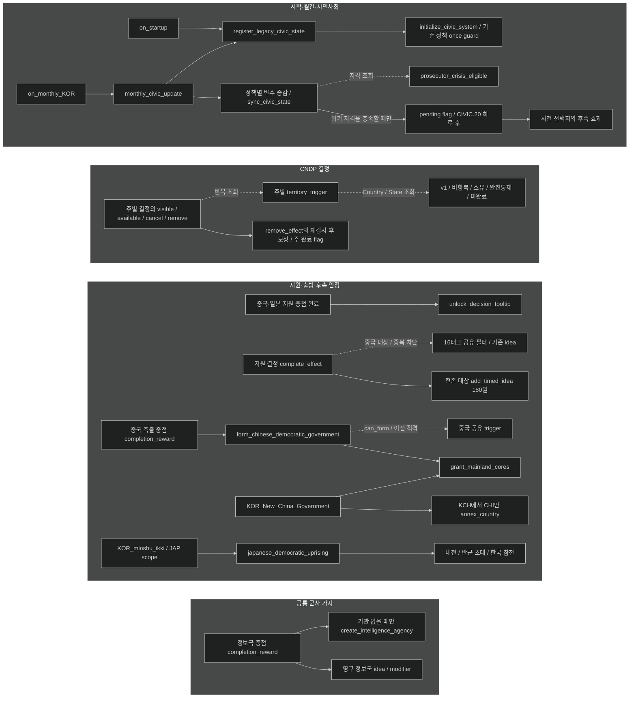

| 경로 | 실제 정의·계약 | 생략하면 안 되는 차이 |
|---|---|---|
| 시작·월간 시민사회 | [on_actions](../../common/on_actions/HOK_KOR_civic_on_actions.txt), [효과](../../common/scripted_effects/HOK_KOR_civic_effects.txt), [공유 조건](../../common/scripted_triggers/HOK_KOR_civic_triggers.txt), [사건](../../events/HOK_KOR_civic_events.txt) | startup과 월간 모두 명시적 KOR 문맥을 쓴다. 초기화·옛 중점 등록은 once guard, 월간 수치는 정책 조건에 따라 다르다. 위기의 자격이 있을 때만 pending과 하루 뒤 사건을 설정한다. |
| CNDP | [결정](../../common/decisions/KOR_decision.txt), [trigger](../../common/scripted_triggers/HOK_KOR_cndp_triggers.txt) | 종료 보상은 `remove_effect`다. 지원 결정의 즉시 `complete_effect`와 혼동하지 않는다. [D25](#d25-cndp-sequence)에서 취소·종료를 구분한다. |
| 지원 | [중점](../../common/national_focus/korea.txt), [결정](../../common/decisions/HOK_KOR_democratic_support.txt), [필터](../../common/scripted_triggers/HOK_KOR_chinese_democratic_support_triggers.txt) | 중점은 해금 안내와 완료 이력을 제공하며 자동 지원금을 지급하지 않는다. 결정 visible은 `has_completed_focus`를 읽는다. |
| 중국 출범·인정 | [효과](../../common/scripted_effects/HOK_KOR_chinese_government_effects.txt), [조건](../../common/scripted_triggers/HOK_KOR_chinese_government_state_triggers.txt), 한국 결정 | 출범과 인정은 core helper만 공유한다. 인정 결정은 출범 helper 재실행이나 모든 군벌 합병이 아니다. |
| 일본 봉기·정보국 | [일본 helper](../../common/scripted_effects/HOK_KOR_democratic_intelligence_effects.txt), [정보국 idea](../../common/ideas/HOK_KOR_democratic_intelligence.txt) | 일본 내전은 CHI 문턱·중국 영토 선택과 별도다. 정보국은 La Résistance 가지이고 산둥은 TfV 진입 조건이다. |

## D06 · 직접 선행·상호 배타·별도 가용 조건

실선 화살표는 실제 `prerequisite`, 화살촉 없는 선은 `mutually_exclusive`, 점선은 별도 가용 조건이다. 선택한 민주 외교·지원 및 공통 군사 가지를 그린다. 연결하지 않은 부모 경로는 실제 소스에서 계속 읽는다.

[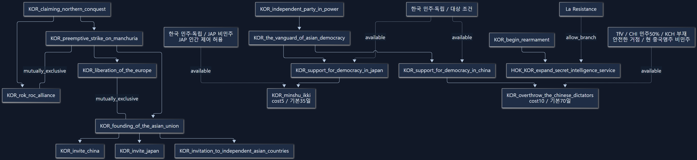](images/D06.dark.svg)

Mermaid 편집 원본

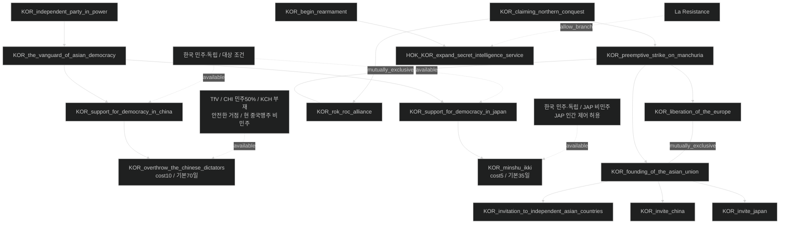

지원 중점과 초대 중점 사이에는 이전 배타 관계를 그리지 않는다. 현재 소스에서 제거된 관계이기 때문이다. 지원의 선행은 Vanguard, 초대의 선행은 Union으로 서로 다르다. 중국 출범 중점은 `cancel_if_invalid = yes`, `continue_if_invalid = no`이며 가용 조건이 유지되어야 한다. 공유 `can_form`은 효과 직전에 TfV·CHI50%·KCH 부재·안전 거점을 재검사하되 중점의 모든 추가 정치 조건을 그대로 복제한 것은 아니다.

근거는 [한국 중점](../../common/national_focus/korea.txt)과 [배치·선행 이식 기록](../implementation/2026-11-20-democratic-support-layout.md)이다. `ai_will_do`와 [역사 AI의 순서](../../common/ai_strategy_plans/KOR_historical_strategy_plan.txt)는 선행 관계와 별도다. 기본 기간은 해당 cost의 명목 기간이며 실제 진행 보정·은행 일수·선택일을 대체하지 않는다.

## D07 · 실제 relative_position_id와 로컬 좌표

실선은 `relative_position_id` 사슬만 뜻한다. 노드의 `(x,y)`는 해당 부모에 대한 로컬 값이다. 점선은 추가로 읽어야 하는 배치 입력이다. 그림에서 상자가 놓인 위치 자체는 HOI4 좌표가 아니다.

[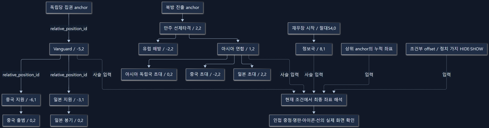](images/D07.dark.svg)

Mermaid 편집 원본

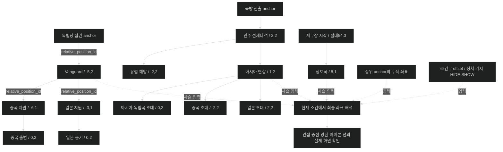

[좌표 정본](../HOK_KOREAN_FOCUS_LAYOUT_COORDINATES.md), [이번 로컬 배치 자료](../data/HOK_KOREAN_DEMOCRATIC_SUPPORT_INTELLIGENCE_PORT_LAYOUT.json), [한국 중점 소스](../../common/national_focus/korea.txt)를 함께 읽는다. 같은 부모를 쓰는 것과 같은 선행을 갖는 것은 별개다. 정보국은 공통 군사 가지로 이동했으므로 이전 민주 HIDE gate를 새 조건인 것처럼 복원하지 않는다. 이 도표는 전체 중점의 실제 화면 충돌 확인을 새로 수행했다는 뜻이 아니다.

## D23 · 반복 민주 지원의 구매·중복 차단·만료

화살표는 정의에 따른 평가·효과 순서이며 사용자 조작을 새로 재현한 기록이 아니다. 중국은 공용 필터를 통과한 **현재 존재하는 정식 16태그 집합**, 일본은 JAP 한 국가를 대상으로 한다.

[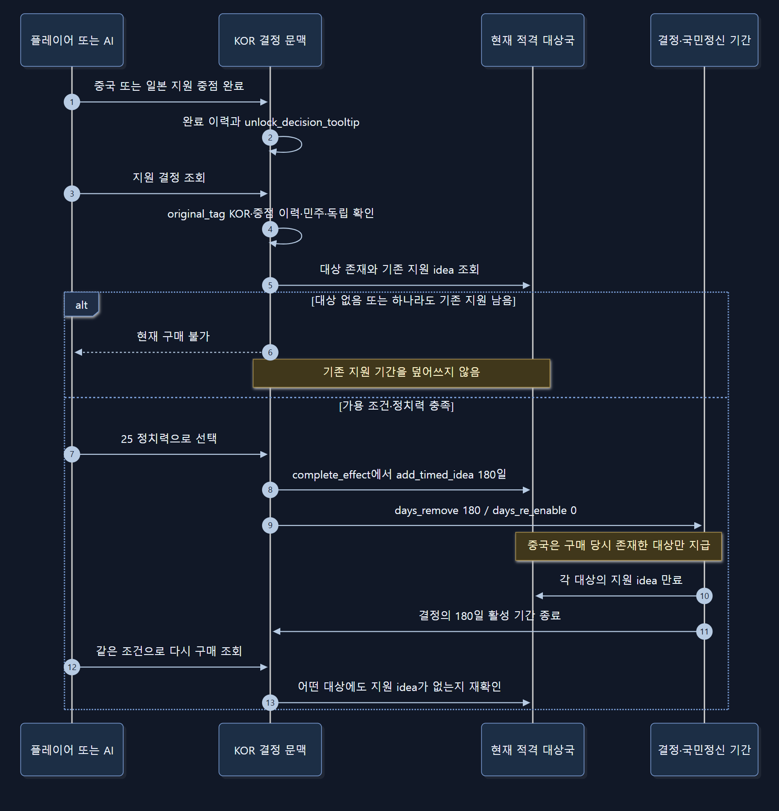](images/D23.dark.svg)

Mermaid 편집 원본

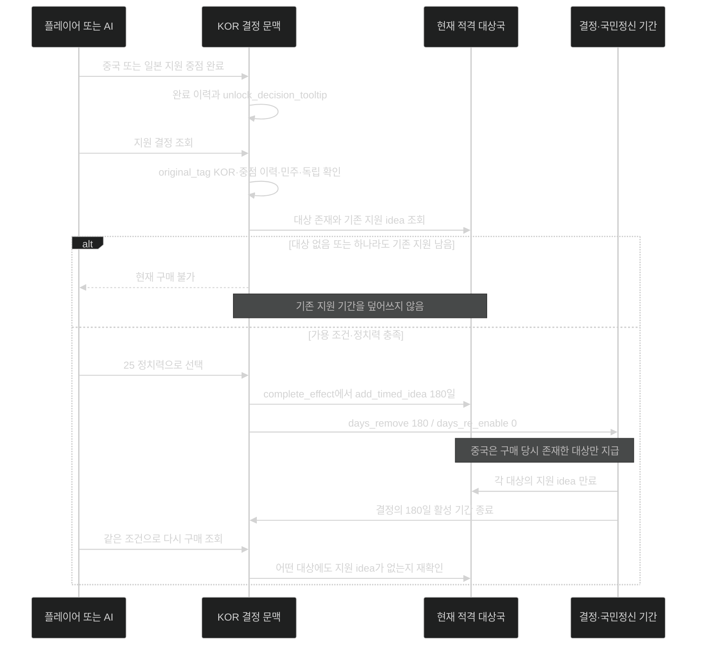

[지원 결정](../../common/decisions/HOK_KOR_democratic_support.txt)의 중국·일본 두 블록과 [공유 필터](../../common/scripted_triggers/HOK_KOR_chinese_democratic_support_triggers.txt)를 정본으로 삼는다. 중국 지원은 동적 내전·협력정부 복제를 제외하며, 현존 대상 하나라도 기존 지원 idea가 남으면 묶음 구매가 차단된다. 예전 280일 지원이나 서로 다른 잔여 기간을 강제로 180일로 초기화하지 않는다. 활성 중간에 출현한 나라에 자동 지급하는 월간 처리도 없다. 일본 결정은 별도 존재·중복 검사이며 중국 timer와 공유하지 않는다.

과거 실제 지원 만료·재구매, 실패한 자동 진단과 별도 수동 증거는 [실행 기록](../implementation/2026-11-20-korean-democratic-support-intelligence-port.md)을 따른다. 이번 시퀀스 작성은 그 검증을 다시 실행한 것이 아니다.

## D24 · 정보국 중점과 기존 기관 재사용

기간선은 명목 중점 진행이다. 새 기관의 모든 세부 설정, 첩보원 자동 모집, 과학자·첩보원 초상화 처리까지 이 중점이 수행한다는 뜻이 아니다.

[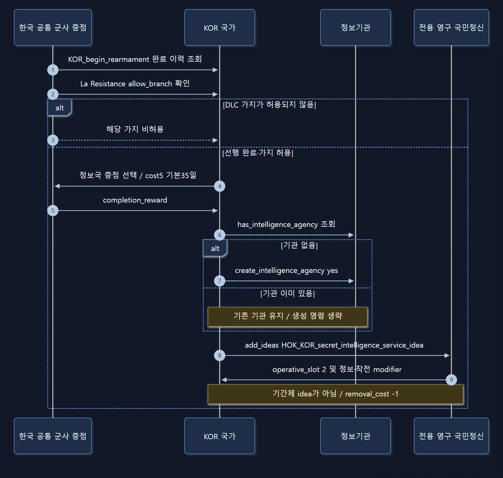](images/D24.dark.svg)

Mermaid 편집 원본

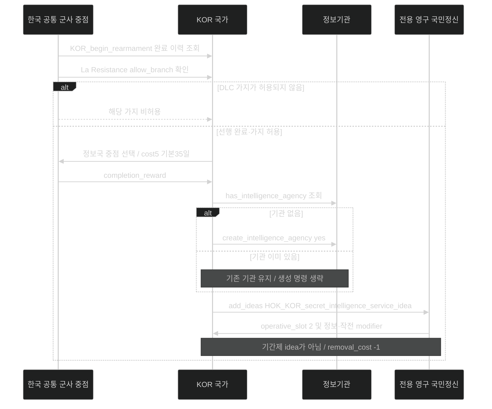

근거: [중점](../../common/national_focus/korea.txt)의 `HOK_KOR_expand_secret_intelligence_service`, [idea 정의](../../common/ideas/HOK_KOR_democratic_intelligence.txt), [역사 AI](../../common/ai_strategy_plans/KOR_historical_strategy_plan.txt). AI 목록은 재무장 뒤 정보국을 배치하지만 실제 선택·완료 시점은 게임 상황에 의존한다. 영구 idea의 `intel_network_gain = 10`과 `intel_network_gain_factor = 0.25`는 서로 다른 modifier다. 전체 수치를 도표에 재정의하지 않고 해당 파일에서 확인한다.

## D25 · CNDP 전북 사업의 착수·취소·종료 재검사

실제 `HOK_KOR_cndp_develop_jeollabuk`를 예로 든다. 모든 사업의 비용·기간·보상까지 같은 것으로 일반화하지 않는다. 전북 State919와 승점 Province13550은 다른 종류의 ID다.

[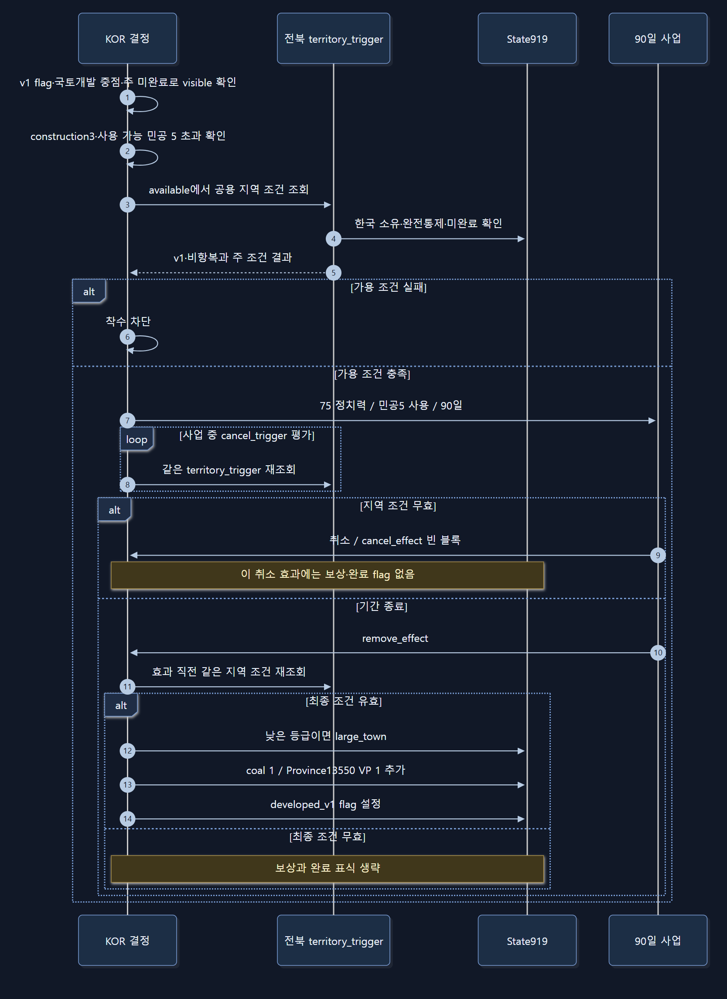](images/D25.dark.svg)

Mermaid 편집 원본

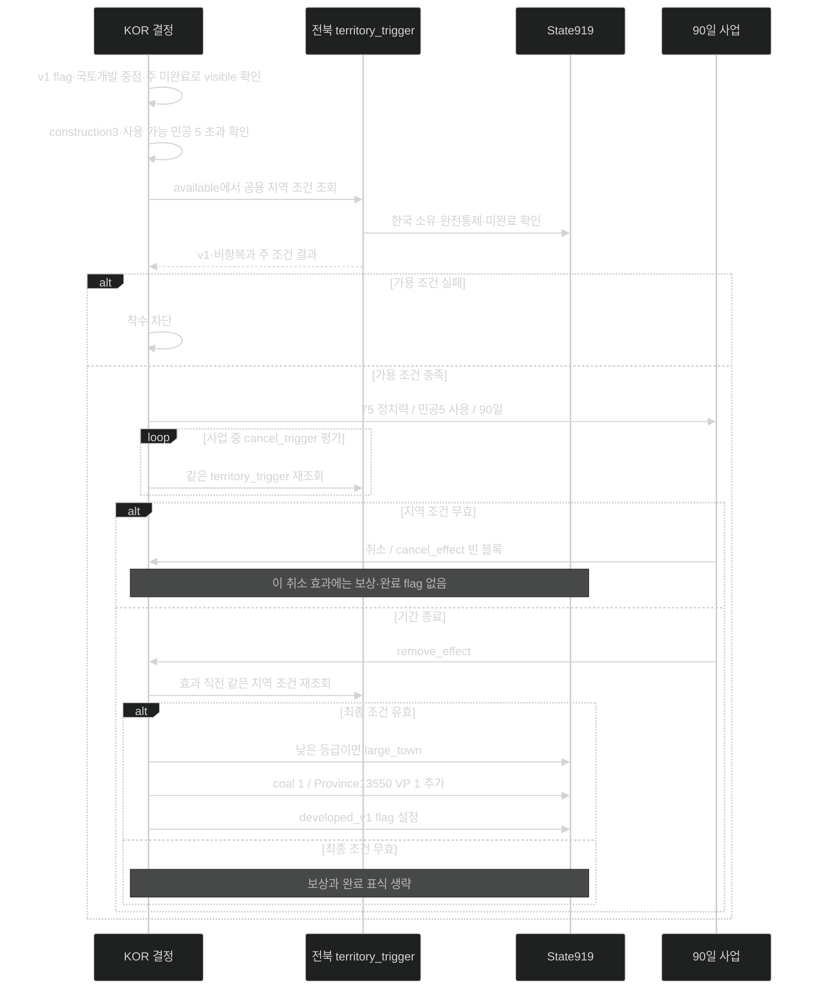

근거: [한국 결정](../../common/decisions/KOR_decision.txt), [CNDP trigger](../../common/scripted_triggers/HOK_KOR_cndp_triggers.txt), [KOR 시작 이력](<../../history/countries/KOR - Korea.txt>), [ADR-0007](../decisions/0007-november-content-integration.md), [실제 이식 기록](../implementation/2026-11-08-hok-upstream-content-port.md). 국가의 `HOK_KOR_cndp_state_projects_v1`과 주의 `HOK_KOR_cndp_developed_v1`은 저장 scope가 다르다. 새 게임은 13개 독립 사업 경로, 해당 국가 버전 표식 없는 저장은 기존 7개 지역 경로를 유지한다. 이 기능 guard는 옛 지도 저장의 마이그레이션이 아니다. 빈 `cancel_effect`에서 비용 환불 같은 미기재 효과를 만들어 설명하지 않는다.

## 처리 대장과 갱신 범위

| 기능·도표 | 처리 | 소스에서 확인한 의미·남은 범위 |
|---|---|---|
| D05 호출·공유 helper | **문서 수정** | 시작·월간 시민사회, CNDP, 중국 출범·인정, 지원·일본·정보국의 실제 진입점을 분리했다. |
| D06 선행·배타 / D07 배치 | **문서 수정** | 실제 부모·로컬 좌표·별도 가용 조건을 명시했다. 지원과 초대의 제거된 배타 관계는 복원하지 않는다. |
| D23–D25 시퀀스 | **문서 추가** | 지원 즉시 지급, 정보국 조건 생성, CNDP 종료 보상·취소·재검사를 각각 구분했다. |
| 기존 ID·비용·기간·공유 조건·완료 표식·AI | **의도적 유지** | 문서가 설명하는 runtime을 변경하지 않는다. 표시와 실제 효과는 별도 관측 대상이다. |
| 모든 중점·사건·DLC 경로의 전수 도식 | **제외** | 현재 주요 공용 구조와 세 기능의 실제 경로를 상세화한다. 생략한 개별 분기는 해당 코드·정본 명세로 연결한다. |
| 실제 선택·기간 경과·효과·새/기존 저장·장기 AI·MP | **미확인 또는 기존 기록 범위** | 이번은 읽기와 문서 작업이다. 이전 기록의 실행 조건·실패·한계를 새 도표 통과로 합산하지 않는다. |

호출자·공유 trigger·기간/취소·정치/DLC 조건이 바뀌면 관련 도표와 [변경 영향 절차](../HOK_CHANGE_COVERAGE_REVIEW.md)를 함께 대조한다. 개념적으로 같은 문구를 쓰더라도 `complete_effect`와 `remove_effect`, 정부 출범과 후속 인정의 효과를 하나로 합치지 않는다.

배치 안내: 독립 사례 그룹은 세로로 읽도록 정렬했다. Mermaid의 `~~~`는 보이지 않는 배치 제약이며 함수 호출·선행 조건·실행 순서를 추가하지 않는다.
