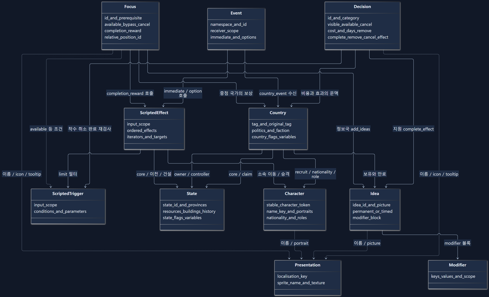
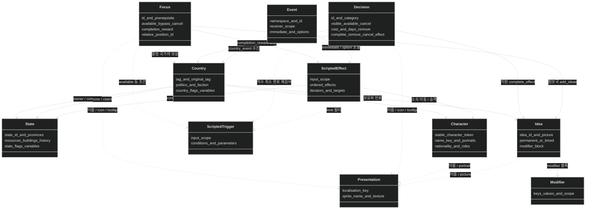
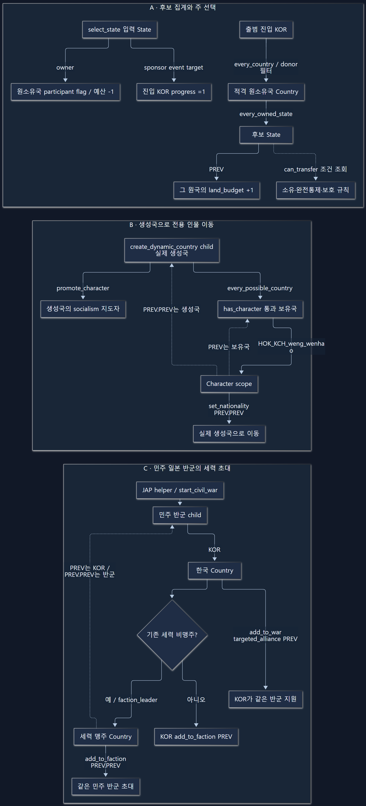
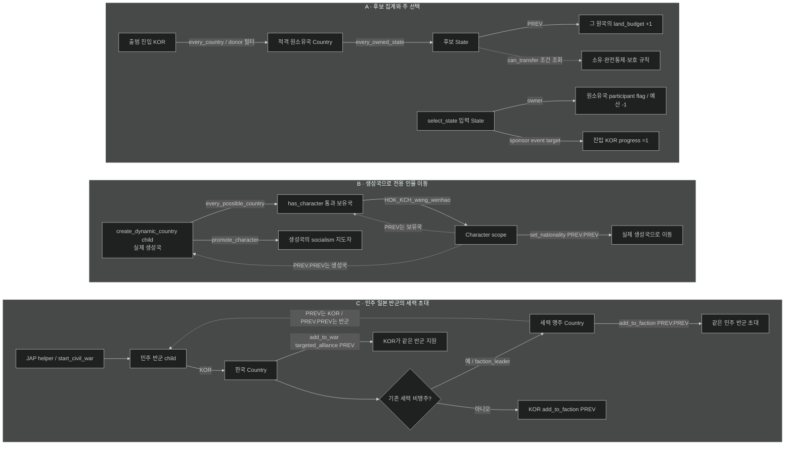

# 콘텐츠 개념과 실제 scope 전환

기준: **2026-11-20, Asia/Seoul**. 호환판 `feat/korean-focus-update-20260922@9a01955785bcdd827c9c85522537a0bfc57ed654` 위 현재 미커밋 소스를 읽은 설명이다. 이번은 문서·도표만 상세화하며 게임 실행 결과를 추가하지 않는다.

[전체 목차](README.md) · [콘텐츠 호출](content-flow.md) · [State 정의](states/definition-and-scope.md) · [상세화 기록](../implementation/2026-11-20-architecture-detail-expansion.md) · [유지 안내](maintenance.md)

UML 모양은 Paradox Script의 정의·ID·문맥을 읽기 위한 개념 표기다. 엔진 C++ 클래스, 상속, 객체 개수나 메모리 수명을 복원한 것이 아니다. 국가 태그와 `original_tag`, 캐릭터 토큰과 저장의 숫자 ID, 주 ID와 표시 키를 구별한다.

## D03 · 국가·주·인물·조건·효과·표시의 관계

실선은 해당 라벨의 보유·실행·정의 관계, 점선은 조건 또는 ID 조회다. 효과가 실행되는 문맥과 데이터를 정의한 물리 파일은 별개다. `Idea`의 보정이 모든 `Modifier`의 유일한 공급자라는 뜻도 아니다.

Mermaid 편집 원본

### 실제 정의와 연결

| 개념·관계 | 현재 소스의 실제 사례 | 읽을 때 구분할 점 |
|---|---|---|
| Focus→Effect→Country/State | [한국 중점](../../common/national_focus/korea.txt)의 `KOR_overthrow_the_chinese_dictators` → [출범 helper](../../common/scripted_effects/HOK_KOR_chinese_government_effects.txt) | `hidden_effect`는 표시 감춤이며 효과 생략이 아니다. `unlock_decision_tooltip` 자체가 결정을 생성하거나 정부를 만드는 효과는 아니다. |
| Decision→Trigger/Idea | [반복 지원 결정](../../common/decisions/HOK_KOR_democratic_support.txt) → [16태그 필터](../../common/scripted_triggers/HOK_KOR_chinese_democratic_support_triggers.txt) → [기존 idea](../../common/ideas/korea.txt)의 `KOR_democrat_sponsored_by_korea` | `complete_effect`에서 당시 존재하는 대상에게 180일 지원을 지급한다. 지급 후 새로 생긴 국가에 소급하는 반복 후크는 없다. |
| Focus→Idea→Modifier | 정보국 중점 → [전용 idea](../../common/ideas/HOK_KOR_democratic_intelligence.txt) | idea는 보유 콘텐츠, `operative_slot = 2` 등은 수치 보정이다. 정보기관 생성은 별도 조건 효과다. |
| Event→Effect/직접 효과 | [시민사회 사건](../../events/HOK_KOR_civic_events.txt), [한국 사건](../../events/korea.txt) | 모든 사건이 공용 helper를 거치지는 않는다. 사건 수신국과 선택지 내부의 대상 scope도 별도로 읽는다. |
| Country→Character | [전용 웡원하오](../../common/characters/HOK_KCH_characters.txt), [KCH 이력](<../../history/countries/KCH - Korean China.txt>) | `HOK_KCH_weng_wenhao`는 별도 토큰이고 이름 키는 `CHI_weng_wenhao`다. 기존 CHI 캐릭터 토큰의 이전이 아니다. |
| Country→State | [이전 조건](../../common/scripted_triggers/HOK_KOR_chinese_government_state_triggers.txt)과 출범 helper | `add_core_of`와 `transfer_state`를 구분한다. 소유, 대표 통제, 전체 Province 통제는 같은 관계가 아니다. |
| 콘텐츠→표시 | [전용 GFX](../../interface/HOK_KOR_democratic_support_intelligence.gfx), [표시 상세](presentation-assets.md) | 이름 키, sprite ID, 실제 texture 경로, 활성 언어·번역 공급자를 따로 추적한다. |

산둥은 `original_tag = KCH`인 동적 국가를 생성한다. 생성국의 실제 태그를 `KCH`나 과거 관측값 `D04`로 고정하지 않고 저장한 event target을 사용한다. Country/State의 flag·variable은 각 scope의 데이터이며 서로 자동 공유되지 않는다.

## D04 · 실제 호출부에서 PREV를 결정하는 세 경로

각 subgraph는 **서로 다른 실행 구간**이다. 실선은 실제 scope 진입, 점선은 해당 위치에서 참조한 이전 문맥이다. `limit`, `if`, `hidden_effect`의 중괄호 개수로 `PREV`를 계산하지 않는다.

Mermaid 편집 원본

### 호출부별 scope 계약

| 구간 | 입력과 참조 | 근거·경계 |
|---|---|---|
| 후보 집계 | donor Country→`every_owned_state`→`PREV` 원국 예산 증가 | [출범 효과](../../common/scripted_effects/HOK_KOR_chinese_government_effects.txt). 후보 수 집계와 선택 시 차감은 별도 단계다. 선택 표식은 소유권 변경이 아니다. |
| 선택 helper | State에 selected flag; `owner`에 participant·예산 차감; sponsor target에 progress | 같은 파일의 `HOK_KOR_chinese_government_select_state`. event target 참조는 단순 `PREV` 참조로 대체하지 않는다. |
| 인물 이동 | 생성국→보유국→Character의 `PREV.PREV`가 생성국 | 같은 파일의 `create_dynamic_country` child. 외부 효과는 별도 저장한 생성국 global target으로 돌아온다. |
| 일본 초대 | 반군→KOR→맹주 위치의 `PREV.PREV`가 반군 | [일본 helper](../../common/scripted_effects/HOK_KOR_democratic_intelligence_effects.txt). 뒤의 `add_to_war`는 여전히 KOR에서 실행한다. 인물 이동과 같은 토큰이어도 호출 사슬은 다르다. |
| CNDP 조회 | 결정 Country→[주별 trigger](../../common/scripted_triggers/HOK_KOR_cndp_triggers.txt)→State의 `is_owned_by = ROOT` | 여기서 ROOT는 해당 결정의 국가다. 다른 사건·on_action의 ROOT/FROM 계약으로 일반화하지 않는다. [S03](states/definition-and-scope.md#s03-country-state-scope)에서 확대한다. |

### 처리와 확인 범위

| 후보 | 처리 | 확인·남은 항목 |
|---|---|---|
| 축약됐던 D03과 D04 | **문서 수정** | 실제 정의·호출부를 읽어 보유/조건/효과/표시와 scope 사슬을 확장했다. 게임 코드는 유지한다. |
| stable ID·국가/주 flag·동적 생성국 참조 | **의도적 유지** | 기존 저장 계약과 현재 helper의 입력·정리 순서를 설명한다. 임의 개명·새 마이그레이션은 없다. |
| 엔진 내부 클래스·전 세계 모든 호출의 전개 | **제외** | 도표의 근거는 공개 모드 소스이며 이 개념도를 엔진 스키마·전수 호출 그래프로 해석하지 않는다. |
| 유효 등록·실제 UI·효과·새/기존 저장 | **미확인 또는 기존 기록 범위** | 이번 작업은 실행하지 않는다. 이전의 한정된 관측·실패·미검증은 [11월20일 구현 기록](../implementation/2026-11-20-korean-democratic-support-intelligence-port.md)과 [11월8일 기록](../implementation/2026-11-08-hok-upstream-content-port.md)을 따른다. |

출처는 원본 HOK의 도메인 질문·개념 분리이며, 내용은 RT56+승인된 HOK 변경의 현재 소스로 적응했다. 관련 관계 변경 시 D03/D04와 호출부를 함께 갱신하고, 표시·지리 변경에는 [검토 절차](../HOK_CHANGE_COVERAGE_REVIEW.md)를 적용한다.

배치 안내: 독립 사례 그룹은 세로로 읽도록 정렬했다. Mermaid의 `~~~`는 보이지 않는 배치 제약이며 함수 호출·선행 조건·실행 순서를 추가하지 않는다.
