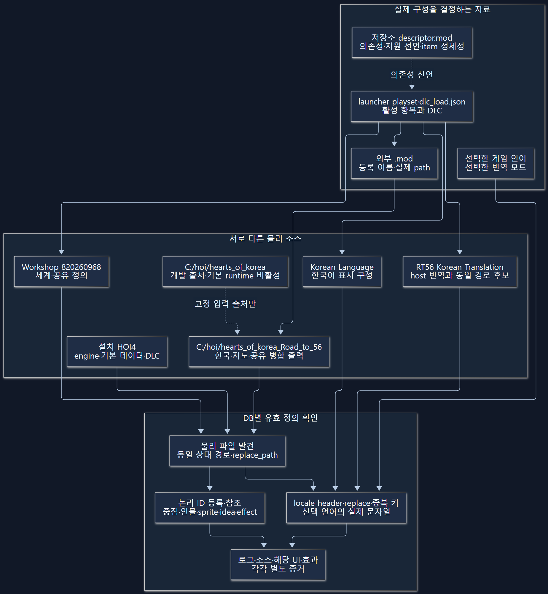
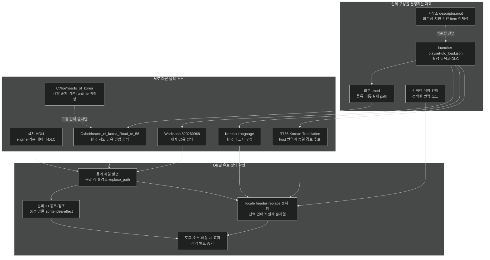
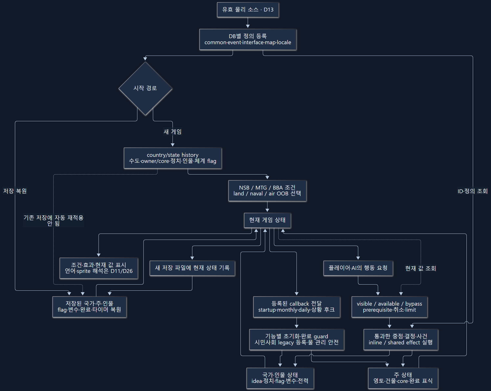
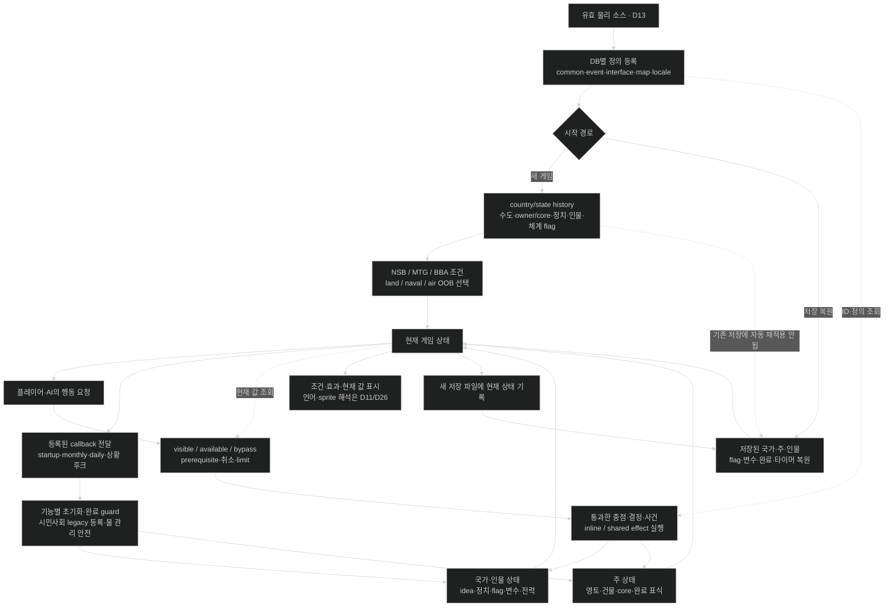
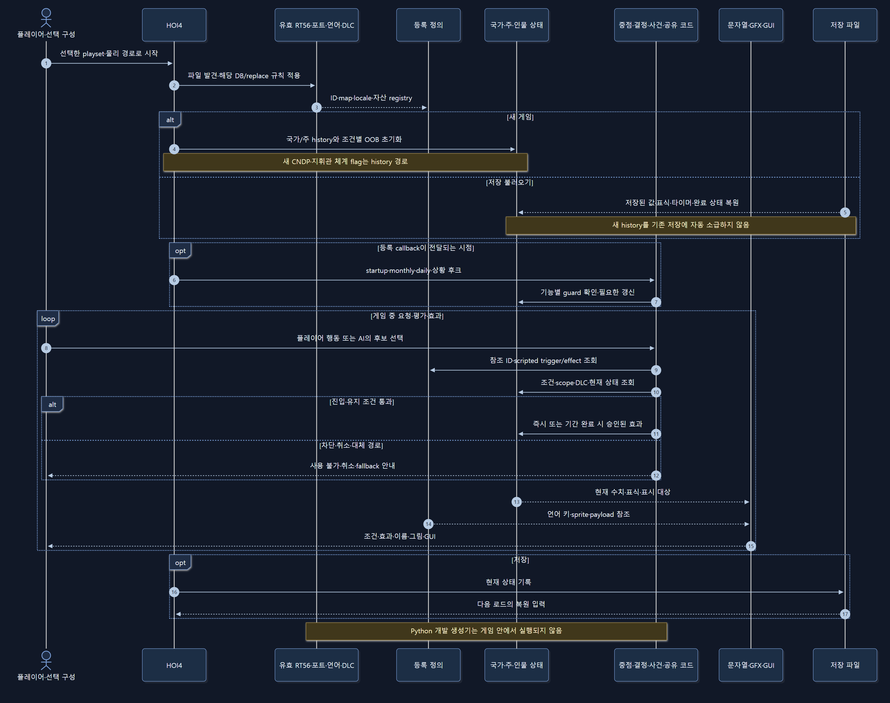
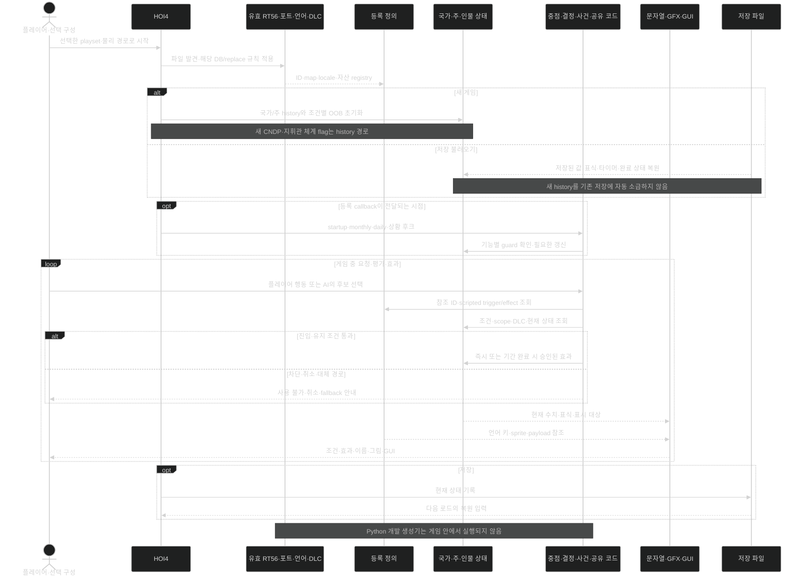

# 물리 소스·정의 등록·게임 수명주기

기준: **2026-11-20, Asia/Seoul**. 호환판 `9a01955785bcdd827c9c85522537a0bfc57ed654` 위 현재 미커밋 작업 트리의 소스 설명이다. 이번 작업은 문서·도표만 상세화한다. 게임 로드·UI·효과·저장은 기존 기록의 소스·조건에 한정하며 새로 실행하지 않았다. [상세화 기록](../implementation/2026-11-20-architecture-detail-expansion.md).

[전체 목차](README.md) · [유지·갱신 안내](maintenance.md) · [문서 인덱스](../README.md)

descriptor 선언, launcher의 선택 목록·물리 path, 게임이 실제로 읽은 정의는 구분한다. 도표는 모든 데이터베이스에 동일한 “뒤 모드 우선” 규칙을 부여하지 않는다.

## D13 · 목표 구성과 읽기 전용 출처

목표 플레이세트의 입력 관계다. 현재 사용자 게임의 실제 선택이나 이번 cold run을 새로 입증한 도표가 아니다.

Mermaid 편집 원본

현재 설치 메타데이터는 `1.20.0.0`, RT56/호환판 descriptor 선언은 `1.19.*`다. 이는 선언과 설치값의 차이이며 실행 실패나 호환 통과의 판정이 아니다. [최신 콘텐츠 구현](../implementation/2026-11-20-korean-democratic-support-intelligence-port.md)과 [기존 의존성 ADR](../decisions/0001-runtime-dependencies-and-load-order.md)의 날짜·범위를 함께 읽는다.

## D14 · 등록·새 게임·저장 복원의 구분

디렉터리를 위에서 아래로 실행하는 pipeline이 아니라 서로 다른 수명주기의 개념도다.

Mermaid 편집 원본

history에 새 표식이나 모집을 추가했다고 기존 저장에서 자동 초기화되는 것은 아니다. 새 저장 왕복과 변경 전 저장 호환은 다르다. [지휘관 guard](../implementation/2026-11-14-korean-commander-unlock-port.md)와 [CNDP 체계](../implementation/2026-11-08-hok-upstream-content-port.md)는 기능별 과거 경로를 보존하지만 지도 이관의 새 게임 전용 경계를 없애지 않는다.

## 물리 경로·등록·복원 계약

| 구분 | 이번에 읽은 소스와 뜻 | 단정하지 않는 부분 |
|---|---|---|
| 포트 descriptor | [descriptor.mod](../../descriptor.mod): RT56·Korean Language·RT56 한국어 번역, `remote_file_id=3796816200`, `supported_version=1.19.*` | 의존성 이름이 실제 활성 playset·DB 우선순위의 증거는 아님 |
| RT56 replace | 읽기 전용 host descriptor의 `history/states`, `map/strategicregions` | 포트 descriptor에 broad replace를 새로 복사하지 않음 |
| 외부 launcher path | [11월10일 동기화 기록](../implementation/2026-11-10-korean-equipment-localisation-repair.md), [의존성 ADR](../decisions/0001-runtime-dependencies-and-load-order.md) | 과거 외부 `.mod`·언어 조합을 현재 세션 선택으로 간주하지 않음 |
| 새 게임 시작 | [KOR 이력](<../../history/countries/KOR - Korea.txt>): 수도525, CNDP/지휘관 버전 flag, DLC별 OOB, 인물 모집 | history 파일 순서를 전체 엔진 초기화 순서로 복원하지 않음 |
| 시민사회 startup/monthly | [on_actions](../../common/on_actions/HOK_KOR_civic_on_actions.txt) → [효과](../../common/scripted_effects/HOK_KOR_civic_effects.txt) | callback 전달과 helper 내부 guard는 별도이며 모든 초기화를 매번 반복하지 않음 |
| 물 관리 안전 | [on_actions](../../common/on_actions/HOK_KOR_soyang_water_gates.txt) → [수문 효과](../../common/scripted_effects/HOK_KOR_soyang_water_gates.txt) | 매일 모든 주를 무조건 수정하는 루프로 설명하지 않음. 관리 global flag·525 controller 등 조건 있음 |
| 저장과 새 버전 | S11의 CNDP, D19의 지휘관, D23의 지원 timer | 새 저장 round trip이 옛 지도 저장 변환·모든 DLC·멀티플레이 보증은 아님 |

## D21 · 프로젝트 전체 실행 경계와 저장의 시퀀스

전체 시스템의 **역할 간 상호작용**을 보여 준다. DB 내부 로드 순서·모든 callback 발생 시점·엔진의 비공개 호출 스택을 복원한 그림은 아니다. 특정 행동의 상세 분기는 D16/D23–D25와 S09를 따른다.

Mermaid 편집 원본

## 처리·범위와 변경 시점

| 후보 | 처리 | 근거·미확인 |
|---|---|---|
| D13 단일 로드 상자 | 수정 | 외부 path·descriptor·파일 충돌·논리 ID·locale을 구분 |
| D14의 단순 로드/저장 화살표 | 수정 | 새 이력·DLC OOB·복원·callback·guard·효과·UI를 분리 |
| D21 전체 상호작용 | 수정 | 이번에 새 시퀀스를 추가. 엔진 내부 DB 순서는 미확인으로 남김 |
| 새 게임/기존 저장 경계 | 의도적 유지 | 기능별 legacy guard와 지도 저장 정책을 혼합하지 않음 |
| 현재 실제 playset·게임 실행 | 제외 | 사용자 설정을 읽어 새 실행 판정을 하거나 게임을 켜지 않음 |

실선은 공급·호출·상태 전달, 점선은 선언·조회·제약이다. 물리 소스·callback·이력·저장 guard가 바뀌면 D13/D14/D21과 해당 기능 그림을 함께 대조한다. 이번 문서·렌더 결과는 [상세화 기록](../implementation/2026-11-20-architecture-detail-expansion.md)에 따로 기록한다.

