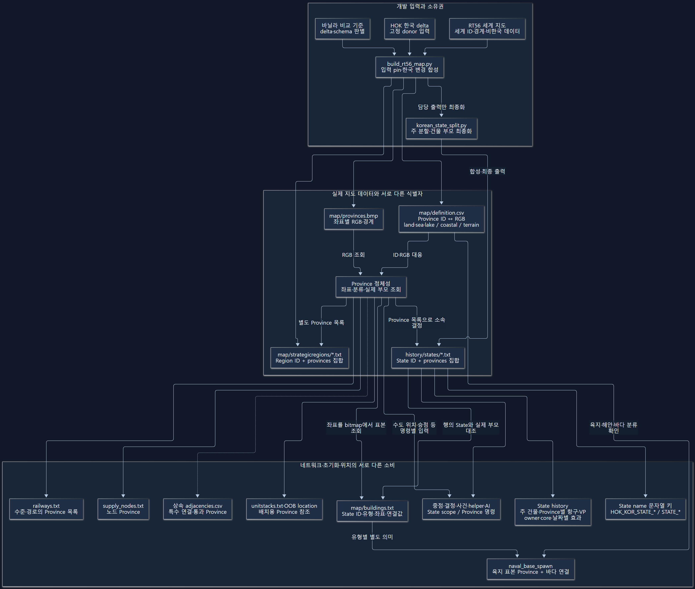
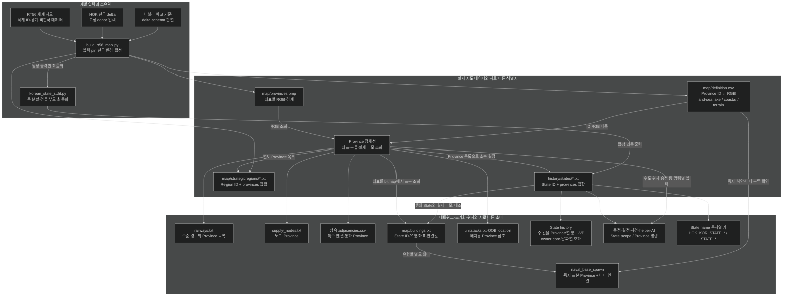
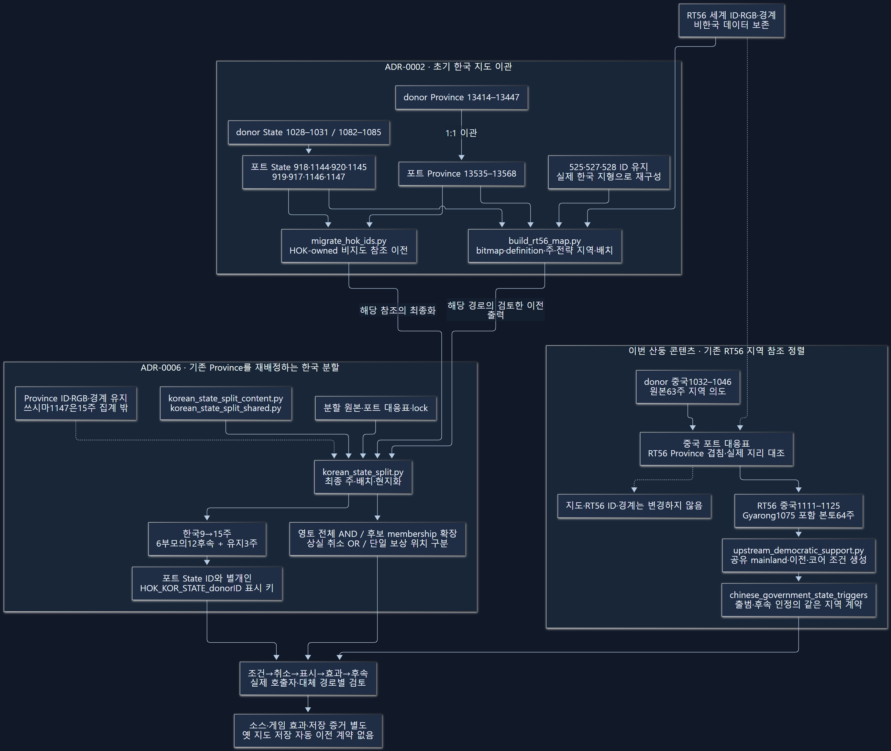
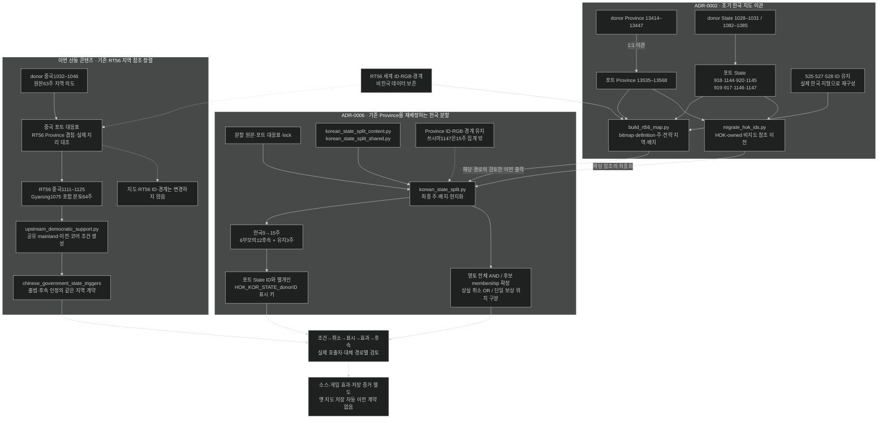

# RT56 지도 데이터와 HOK 지역 변경의 상세 관계

소스 읽기 기준: **2026-11-20, Asia/Seoul**, 호환판 `9a01955785bcdd827c9c85522537a0bfc57ed654` 위 미커밋 작업 트리. 이번 변경은 문서 상세화이며 지도 생성기·입력·게임 파일은 변경하지 않는다. 과거 지도·게임 검증은 해당 ADR와 구현 기록의 당시 조건에 한정한다. 이번 문서 작업의 범위·산출물은 [상세화 기록](../implementation/2026-11-20-architecture-detail-expansion.md)을 따른다.

[전체 목차](README.md) · [State 상세](states/README.md) · [개발 생성 과정](source-and-generation.md) · [유지 안내](maintenance.md)

지도 정본은 **RT56 세계 지도 + 승인된 HOK 한국 변경**이다. donor 지도 전체나 바닐라 지도를 RT56의 대체물로 사용하지 않는다. 아래 그림은 데이터의 공급·참조 관계이며 HOI4의 파일 읽기 순서나 지도 경계의 실제 모양을 표현하지 않는다.

## D09 · 좌표·Province·State·전략 지역과 토폴로지

실선은 라벨에 적힌 데이터 공급·ID 조회 관계, 점선은 상속 또는 별도 교차 확인이다. State ID, Province ID, Strategic Region ID와 표시 키는 서로 다른 참조다. State와 Strategic Region은 각각 Province를 묶으며 둘 사이에 단일 포함 계층을 가정하지 않는다.

Mermaid 편집 원본

### 실제 파일·참조 계약

| 소비 위치 | 입력의 종류와 확인할 연결 | 소스 |
|---|---|---|
| Province 정의·픽셀 | `definition.csv`의 ID/RGB와 bitmap RGB를 연결한다. 좌표의 색이 존재한다는 사실과 의도한 한국 Province라는 사실을 따로 확인한다. | [definition](../../map/definition.csv), [bitmap](../../map/provinces.bmp), [합성 코드](../../tools/build_rt56_map.py) |
| State와 전략 지역 | 두 파일군이 각각 `provinces` 집합을 소비한다. State 번호를 전략 지역 번호로 치환하지 않는다. 분할한 주의 Province 부모와 전략 지역 membership을 함께 확인한다. | [주 이력](../../history/states/), [한국 전략 지역](../../map/strategicregions/186-Korea.txt) |
| 철도·보급 | 철도는 Province 경로, 보급 노드는 Province 위치다. State 분할만으로 철도 경로를 복제하거나 바꾸지 않는다. | [railways](../../map/railways.txt), [supply_nodes](../../map/supply_nodes.txt) |
| 특수 인접 | donor에 별도 adjacency delta가 없다는 ADR-0002 결정에 따라 호스트/기본 정의를 상속한다. bitmap의 육지 인접과 특수 adjacency 행을 같은 자료로 취급하지 않는다. | [ADR-0002](../decisions/0002-map-id-migration.md) |
| 모델 배치·항구 spawn | `buildings.txt` 행은 배치 자료다. 첫 State ID·실제 좌표의 Province 부모를 대조하며, 감사한 `naval_base_spawn`은 육지/해안과 연결 바다 Province까지 확인한다. 행이 있다고 실제 항구·공장이 지급되는 것은 아니다. | [buildings](../../map/buildings.txt), [건물 합성·표본 조회](../../tools/build_rt56_map.py), [분할 후 재귀속](../../tools/korean_state_split.py) |
| 실제 건물·승점 | `history.buildings`의 주 수준 값과 Province로 묶인 항구 등은 서로 다르다. `victory_points`는 Province ID·점수 쌍이다. 황해남917은 VP13559를 기록하며 RT56용 `state_victory_points` 배열 hook도 둔다. | [황해남917](../../history/states/917-Hwanghae.txt), [S02](states/definition-and-scope.md#s02-state-file-tree) |
| 배치·콘텐츠 | `unitstacks`·OOB 위치, 수도·건물·코어·이전·highlight는 각 명령의 입력과 scope를 읽는다. 같은 숫자 검색만으로 이전 대상을 정하지 않는다. | [unitstacks](../../map/unitstacks.txt), [참조 이전기](../../tools/migrate_hok_ids.py), [주 참조 스킬](../skills/hok-rt56-state-reference-review/SKILL.md) |

`build_rt56_map.py`의 항구 보정은 donor–바닐라 두 입력의 차집합만으로 끝내지 않는다. RT56이 제거했던 vanilla-identical 행 중 필요한 한국 `naval_base_spawn` **7행만** 별도로 복원한 계약이다. 기존 ADR의 좌표·바이트·정적 수치는 당시 기록이며, 이번 문서 작성에서 생성기나 게임을 실행해 다시 입증한 결과가 아니다.

## D10 · 지도 이관·주 분할·콘텐츠 지역 정렬의 구분

실선은 승인된 개발 변환 또는 참조 전달이다. 점선은 변경하지 않는 기반·정책이다. 두 차례 한국 지도 작업과 이번 중국 콘텐츠 정렬은 변경 대상이 서로 다르다. 숫자 매핑의 정본은 ADR·JSON·담당 잠금이며 그림이 새 ID 할당 규칙이 되지 않는다.

Mermaid 편집 원본

### 원본·호스트·포트의 대응과 의미

| 대상 | 담당 정본과 실제 사용 | 보존·예외 |
|---|---|---|
| 초기 Province·State 이전 | [ADR-0002](../decisions/0002-map-id-migration.md), [map builder](../../tools/build_rt56_map.py), [비지도 참조 이전기](../../tools/migrate_hok_ids.py) | RT56의 같은 번호를 HOK 지리로 덮지 않는다. 초기 숫자·픽셀 수는 해당 핀의 역사이며 미래 RT56의 빈 ID 목록이 아니다. |
| 한국 15주·전체 분할 | [ADR-0006](../decisions/0006-korean-state-split-integration.md), [포트 대응 JSON](../data/HOK_KOREAN_STATE_SPLIT_PORT_MAPPING.json), [구현 기록](../implementation/2026-11-07-korean-state-split-port.md), [전체 관계 S05](states/geography-and-splits.md#s05-korean-split-map) | 기존6부모와 신설1148–1153을 연결한다. 경기525·강원1144·제주1146은 분할하지 않은3주다. 주 수의 변화가 Province 신설을 뜻하지 않는다. |
| 논리 표시 키 | 분할 JSON의 `name_key`, 주 파일의 `name`, [한영 주 이름](../../localisation/english/HOK_KOR_state_split_l_english.yml) | 황해남은 State917, 표시 키는 `HOK_KOR_STATE_1083`이다. 접미사1083을 State scope로 사용하지 않는다. 쓰시마는 별도 `STATE_1147`을 사용한다. |
| 중국 본토·거점·보호 집합 | [이번 지역 대응표](../data/HOK_KOREAN_CHINESE_GOVERNMENT_RT56_MAPPING.json), [지역별 판정 기록](../implementation/2026-11-20-chinese-government-state-mapping.md), [공유 trigger](../../common/scripted_triggers/HOK_KOR_chinese_government_state_triggers.txt) | 중국63→64는 실제 RT56 지역 구획에 맞춘 선택·코어 목록이다. 난징Province11913의 부모는 포트1114이며 donor1035와 숫자가 다르다. 이전 적격·소유·통제는 지역 membership 외에 추가 조건이다. |
| 생성 출력 소유권 | [분할 모듈](../../tools/korean_state_split.py), [한국 소비자](../../tools/korean_state_split_content.py), [공유 연결](../../tools/korean_state_split_shared.py), [이번 업데이트 생성기](../../tools/upstream_democratic_support.py) | 해당 계층의 입력·잠금·출력 계약으로 생성한다. 그림의 화살표가 모든 builder를 임의 순서로 일괄 실행해도 된다는 뜻은 아니다. 개발 절차는 [D08/D20](source-and-generation.md)에서 구분한다. |

### 처리 범위와 갱신 조건

| 처리 | 이번 문서에서의 판단 |
|---|---|
| 수정 | D09를 좌표·식별자·집합·네트워크·초기 건물·모델 위치로 분리하고 D10을 초기 이관·주 분할·중국 참조 정렬로 상세화했다. 실제 파일·담당 생성기에 연결했다. |
| 의도적 유지 | RT56 세계 소유권, 승인된 ID 대응과 한국15주 정책, 안정적인 표시 키, 기존 효과·보상·지도·저장 정책을 유지한다. 이전 검증을 새 문서 작업의 게임 결과로 재집계하지 않는다. |
| 제외 | 지도 생성·숫자 교체·호스트 갱신·전 세계 개별 주의 전수 지도·기존 저장 변환·게임 실행은 이 문서 변경에서 수행하지 않는다. 전체 한국 분할 상세와 산둥 선택 분기는 해당 State·산둥 페이지가 담당한다. |
| 미확인 | 모든 외국 콘텐츠의 동적 Province/State 참조, 모든 DLC/북마크의 지리·경로·화면·장기 저장 상태는 이 도표로 입증되지 않는다. 실제 유효 참조와 엔진 동작은 해당 소스/실행 구성에서 확인해야 한다. |

Province·State·전략 지역 membership, 건물·항구 spawn·철도·보급·위치 또는 콘텐츠의 지역 의미가 바뀌면 D09/D10과 연결된 State 도표를 대조한다. [주 참조 스킬](../skills/hok-rt56-state-reference-review/SKILL.md)과 [변경 영향 절차](../HOK_CHANGE_COVERAGE_REVIEW.md)에 따라 호출자·조건·취소·highlight·보상·후속을 **수정/유지/제외/미확인**으로 남긴다. 지도 정의의 숫자가 유효한 것과 의도한 지역인 것은 별도로 확인한다.

