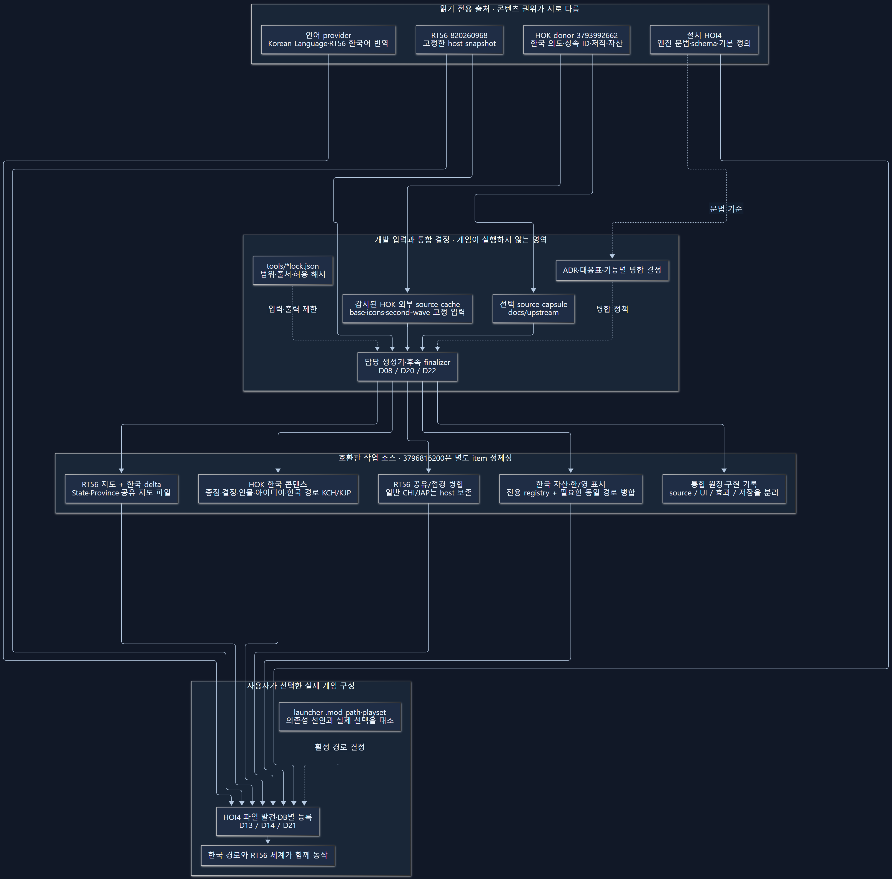
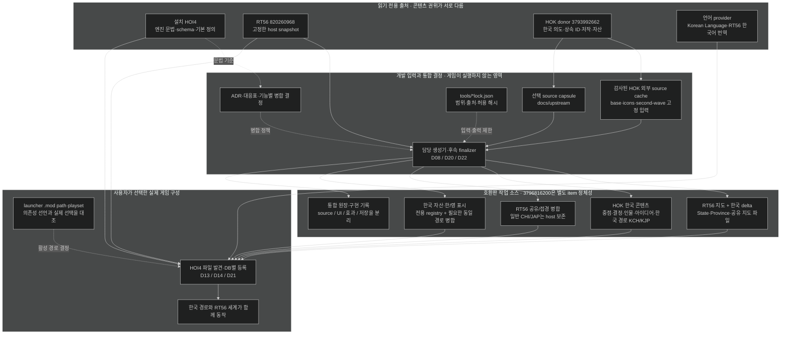
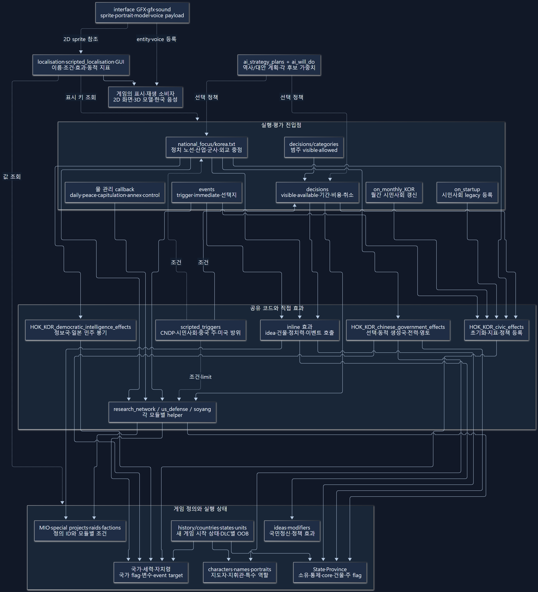

# HOK×RT56 전체 구성과 콘텐츠 소유권

기준: **2026-11-20, Asia/Seoul**. 호환판 `9a01955785bcdd827c9c85522537a0bfc57ed654` 위 현재 미커밋 작업 트리의 소스 설명이다. 이번 작업은 문서·도표만 상세화한다. 게임 로드·UI·효과·저장은 기존 구현 기록의 당시 소스·조건에 한정하며 새로 실행하지 않았다. [상세화 기록](../implementation/2026-11-20-architecture-detail-expansion.md).

[전체 목차](README.md) · [유지·갱신 안내](maintenance.md) · [문서 인덱스](../README.md)

현재 소스는 RT56 세계에 검토한 HOK 한국 콘텐츠를 병합한다. donor는 읽기 전용 개발 입력이며 목표 플레이세트의 활성 의존성이 아니다. 실선은 라벨의 입력·이용 관계이며 모든 폴더의 실행 순서가 아니다.

## D01 · 네 소스와 하나의 작업 결과

출처의 권위와 물리적 소유자를 나눈다. 화살표는 의도한 통합 관계이며 실제 VFS 우선순위 증거가 아니다.

Mermaid 편집 원본

근거: [소유권 ADR](../decisions/0004-hok-korean-content-priority.md), [기존 포팅 정책](../PORTING_ARCHITECTURE.md), [descriptor](../../descriptor.mod). HOK `2898629778`·`3793992662`는 출처, RT56 `820260968`은 호스트, `3796816200`은 기록된 별도 호환판 ID다. 도표 작성은 게시 승인이 아니다.

## D02 · 게임 콘텐츠 모듈과 공용 접점

모듈 간 대표 참조다. 모든 중점·결정이 scripted effect를 반드시 통과하는 것은 아니다.

```mermaid
---
config:
  theme: dark
---
flowchart TB
    subgraph Entry["실행·평가 진입점"]
        Focus["national_focus/korea.txt<br/>정치 노선·산업·군사·외교 중점"]
        Category["decisions/categories<br/>범주 visible·allowed"]
        Decision["decisions<br/>visible·available·기간·비용·취소"]
        Event["events<br/>trigger·immediate·선택지"]
        Startup["on_startup<br/>시민사회 legacy 등록"]
        Monthly["on_monthly_KOR<br/>월간 시민사회 갱신"]
        Safety["물 관리 callback<br/>daily·peace·capitulation·annex·control"]
    end
    subgraph Logic["공유 코드와 직접 효과"]
        Triggers["scripted_triggers<br/>CNDP·시민사회·중국 주·미국 방위"]
        Civic["HOK_KOR_civic_effects<br/>초기화·지표·정책 등록"]
        China["HOK_KOR_chinese_government_effects<br/>선택·동적 생성국·전력·영토"]
        Intel["HOK_KOR_democratic_intelligence_effects<br/>정보국·일본 민주 봉기"]
        Other["research_network / us_defense / soyang<br/>각 모듈별 helper"]
        Direct["inline 효과<br/>idea·건물·정치력·이벤트 호출"]
    end
    subgraph Data["게임 정의와 실행 상태"]
        History["history/countries·states·units<br/>새 게임 시작 상태·DLC별 OOB"]
        Country["국가·세력·자치령<br/>국가 flag·변수·event target"]
        State["State·Province<br/>소유·통제·core·건물·주 flag"]
        Person["characters·names·portraits<br/>지도자·지휘관·특수 역할"]
        Ideas["ideas·modifiers<br/>국민정신·정책 효과"]
        Systems["MIO·special projects·raids·factions<br/>정의 ID와 모듈별 조건"]
    end
    AI["ai_strategy_plans + ai_will_do<br/>역사/대안 계획·각 후보 가중치"]
    UI["localisation·scripted_localisation·GUI<br/>이름·조건·효과·동적 지표"]
    Art["interface GFX·gfx·sound<br/>sprite·portrait·model·voice payload"]
    Media["게임의 표시·재생 소비자<br/>2D 화면·3D 모델·한국 음성"]
    Category --> Decision
    Focus --> Civic
    Focus --> China
    Focus --> Intel
    Focus --> Other
    Focus --> Direct
    Decision --> Civic
    Decision --> Other
    Decision --> Direct
    Event --> Civic
    Event --> Other
    Event --> Direct
    Startup --> Civic
    Monthly --> Civic
    Safety --> Other
    Triggers -. 조건 .-> Focus
    Triggers -. 조건 .-> Decision
    Triggers -. 조건·limit .-> Other
    History --> Country
    History --> State
    History --> Person
    Civic --> Country
    China --> Country
    China --> State
    China --> Person
    Intel --> Country
    Direct --> Ideas
    Direct --> State
    Direct --> Systems
    Other --> Country
    Other --> State
    Other --> Systems
    AI -. 선택 정책 .-> Focus
    AI -. 선택 정책 .-> Decision
    UI -. 표시 키 조회 .-> Entry
    UI -. 값 조회 .-> Data
    Art -. 2D sprite 참조 .-> UI
    Art -. entity·voice 등록 .-> Media
    UI --> Media
```

Mermaid 편집 원본

현재 입구: [한국 중점](../../common/national_focus/korea.txt), [한국 결정](../../common/decisions/KOR_decision.txt), [시민사회 효과](../../common/scripted_effects/HOK_KOR_civic_effects.txt), [월간 후크](../../common/on_actions/HOK_KOR_civic_on_actions.txt). 한국 경로가 만드는 KCH/KJP는 한국 소유 콘텐츠이며 일반 CHI/JAP 전체를 HOK donor로 교체하지 않는다.

새 기능군·공용 helper·소유권이 바뀌면 D01/D02를 대조한다. 수치만 바뀌고 관계가 같다면 전체 구성도 재생성 대신 유지 근거를 기록한다.

## 모듈별 실제 코드 입구

아래는 대표 파일에서 하위 정의를 찾아가는 색인이다. 하나의 폴더에 있는 모든 파일이 같은 시각에 실행된다는 뜻이 아니다. 실선은 라벨의 입력·호출·상태 변경, 점선은 정책·조건·표시 조회다. D02의 모듈 묶음에는 여러 함수가 포함되므로 모든 진입점이 모든 하위 효과를 호출하는 것으로 읽지 않는다.

| 기능군 | 실제 입구·공유 정의 | 이어 볼 도표 |
|---|---|---|
| 한국 중점·정치·산업·군사 | [korea.txt](../../common/national_focus/korea.txt), [국민정신](../../common/ideas/korea.txt) | D03–D07 |
| 지역 사업·부지·자원 | [KOR_decision](../../common/decisions/KOR_decision.txt), [CNDP 조건](../../common/scripted_triggers/HOK_KOR_cndp_triggers.txt) | S03/S10–S12, D25 |
| 시민사회·정책 | [시민사회 효과](../../common/scripted_effects/HOK_KOR_civic_effects.txt), [후크](../../common/on_actions/HOK_KOR_civic_on_actions.txt), [GUI](../../interface/HOK_KOR_civic_influence.gui) | D05/D14/D21 |
| 중국·일본 민주 지원·정보국 | [지원 결정](../../common/decisions/HOK_KOR_democratic_support.txt), [정보국/일본 효과](../../common/scripted_effects/HOK_KOR_democratic_intelligence_effects.txt) | D15–D18/D23/D24 |
| 산둥 정부·후속 인정 | [출범 효과](../../common/scripted_effects/HOK_KOR_chinese_government_effects.txt), [영토 조건](../../common/scripted_triggers/HOK_KOR_chinese_government_state_triggers.txt) | D15–D18, S07–S09 |
| 미국 방위 협력·연구망 | [방위 효과](../../common/scripted_effects/HOK_KOR_us_defense_effects.txt), [연구망 효과](../../common/scripted_effects/HOK_KOR_research_network_effects.txt) | D02/D05/D11 |
| 소양강 수문 관리 | [수문 효과](../../common/scripted_effects/HOK_KOR_soyang_water_gates.txt), [안전 callback](../../common/on_actions/HOK_KOR_soyang_water_gates.txt) | D02/D21, S06/S10 |
| 국가·인물·시작 전력 | [한국 이력](<../../history/countries/KOR - Korea.txt>), [인물](../../common/characters/KOR.txt), [OOB](../../history/units/) | D03/D04/D14/D19 |
| 세계·한국 지도 | [지도 생성기](../../tools/build_rt56_map.py), [State](../../history/states/), [분할 계층](../../tools/korean_state_split.py) | D08–D10/D20/D22, S01–S12 |
| AI | [역사 계획](../../common/ai_strategy_plans/KOR_historical_strategy_plan.txt), [대안 계획](../../common/ai_strategy_plans/KOR_alternate_strategy_plan.txt) | D05–D07 |
| MIO·특별 프로젝트·습격·세력 | [MIO](../../common/military_industrial_organization/organizations/KOR_organization.txt), [습격](../../common/raids/HOK_KOR_naval_commando_raids.txt), [세력](../../common/factions/templates/HOK_KOR_factions.txt) | D02/D03, 해당 정의의 ID 참조 |
| 표시·자산 | [현지화](../../localisation/), [interface](../../interface/), [gfx](../../gfx/), [음성](../../sound/r56_vo_Korean.asset) | D11/D12/D26 |

## 상세화 처리와 범위

| 후보 | 처리 | 이번 근거·한계 |
|---|---|---|
| D01의 단일 병합 상자 | 수정 | 출처·고정 입력·담당 writer·runtime 공급자를 나누었다. 실제 VFS 선택을 새로 측정한 결과는 아니다. |
| D02의 공통 helper 한 개 | 수정 | 현재 존재하는 기능군·직접 효과·callback·정의·표시를 구분했다. 모든 함수의 전수 호출 그래프는 아니다. |
| HOK donor 비활성·RT56 세계 소유권 | 의도적 유지 | ADR-0004와 현재 descriptor·생성 구조를 따른다. |
| 모든 기능의 실제 플레이·장기 AI | 제외 | 이번은 문서·그림 작업이다. 기존 실행 결과는 각 구현 기록의 소스·조건에만 적용한다. |
| 유효 DB 우선순위·외부 번역 조합 | 미확인 | 파일/ID/replace 정책과 실제 구성에 따라 D13/D11의 추가 확인이 필요하다. |
