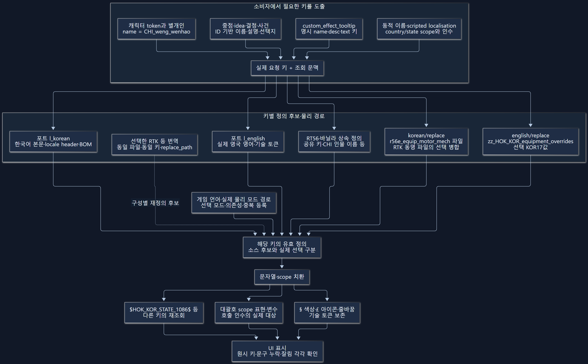
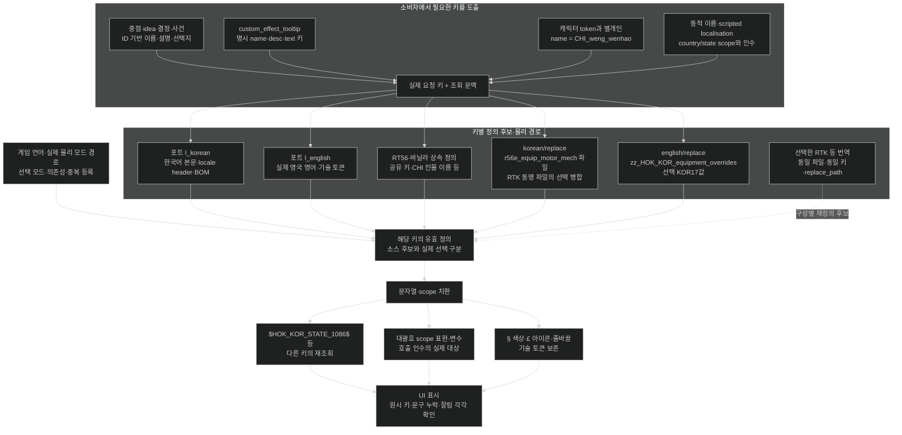
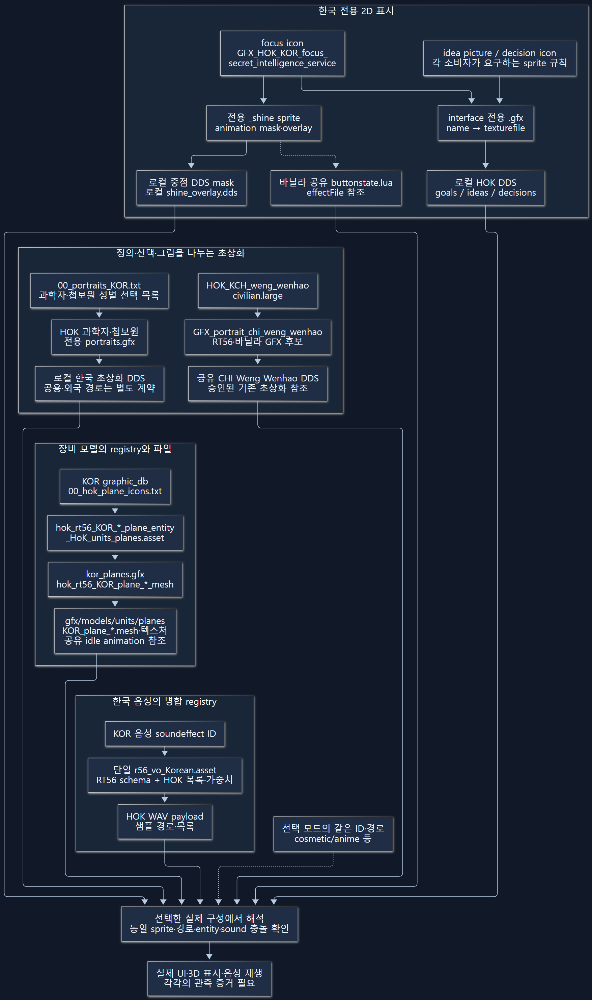
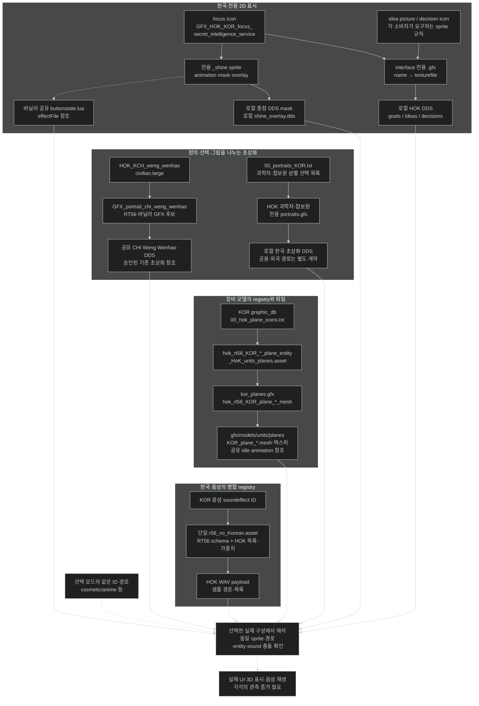
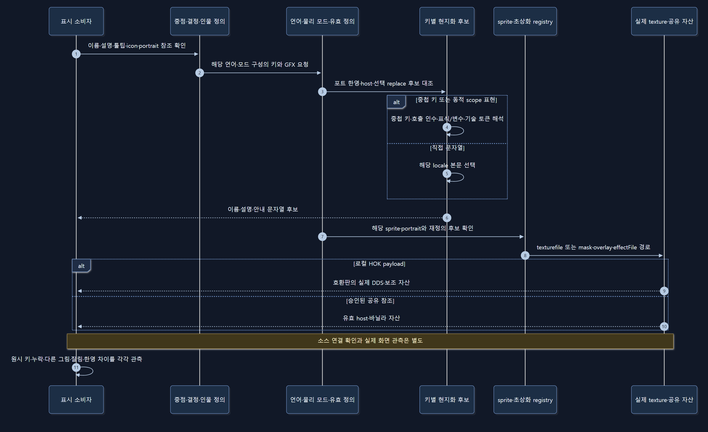
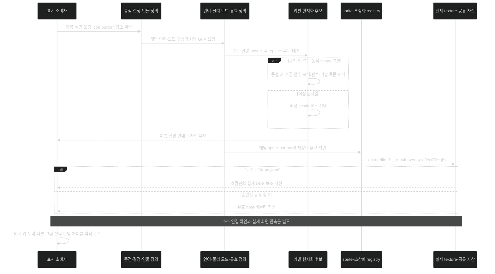

# 현지화·이미지·모델·음성의 상세 표시 경로

소스 읽기 기준: **2026-11-20, Asia/Seoul**, 호환판 `9a01955785bcdd827c9c85522537a0bfc57ed654` 위 미커밋 작업 트리. 이번 변경은 문서이며 현지화 값·GFX·DDS·모델·음성·모드 구성을 변경하지 않는다. 관계 설명, 문서 렌더링, 게임 화면·효과·저장 증거를 구분한다. 이번 문서 작업의 범위·산출물은 [상세화 기록](../implementation/2026-11-20-architecture-detail-expansion.md)을 따른다.

[전체 목차](README.md) · [도메인](domain-model.md) · [로드와 수명주기](load-and-lifecycle.md) · [유지 안내](maintenance.md)

포트는 한국어와 실제 영국 영어를 제공한다. donor의 두 채널 한국어 본문 정책을 가져오지 않는다. **콘텐츠의 논리 ID**, **문자열·sprite 등록**, **실제 파일 payload**, **선택 구성에서의 유효 정의**, **실제 화면**은 각각 추적할 단계다.

## D11 · 소비자·언어·덮어쓰기 후보에서 문자열 치환까지

실선은 요청·정의 후보·치환의 연결이며 점선은 선택한 구성에 따라 개입하는 재정의 후보다. 후보 사이 화살표는 엔진의 보편적인 로드 우선순위 선언이 아니다. 모든 키가 모든 파일에 존재하거나 모든 ID가 같은 이름의 현지화 키를 요구하지 않는다.

Mermaid 편집 원본

### 키와 공급자를 끝까지 추적하는 실제 사례

| 소비자·단계 | 실제 소스 연결과 의미 | 한계·주의 |
|---|---|---|
| 산둥 고유 효과 안내 | [한국 중점](../../common/national_focus/korea.txt)의 `custom_effect_tooltip = HOK_KOR_chinese_government_effect_tt` → [한국어](../../localisation/korean/HOK_KOR_chinese_government_l_korean.yml) / [영어](../../localisation/english/HOK_KOR_chinese_government_l_english.yml) | 두 채널의 대상·수치·기술 토큰을 맞추되 본문 바이트는 언어에 맞게 다르다. 안내 키가 있다는 사실이 실제 모든 효과를 검증한 것은 아니다. |
| 인물 ID와 이름 키 | [캐릭터](../../common/characters/HOK_KCH_characters.txt)의 ID는 `HOK_KCH_weng_wenhao`, `name`은 `CHI_weng_wenhao`다. 이름은 RT56/바닐라 후보에서 상속한다. | 새 캐릭터 token과 같은 이름의 번역을 무조건 추가하지 않는다. 초상화는 D12의 별도 경로다. |
| 논리 주 이름의 중첩 | [영어 연구망 툴팁](../../localisation/english/HOK_KOR_research_network_l_english.yml)의 `$HOK_KOR_STATE_1086$` → [주 이름 정의](../../localisation/english/HOK_KOR_state_split_l_english.yml) → 경남 포트State1148의 표시 의미 | `1086`은 표시 키 일부다. State1086 scope로 실행하는 것이 아니며, 시설의 실제 우선 주·fallback은 helper와 대조한다. |
| 한국어 장비명 | [한국어 replace 병합](../../localisation/korean/replace/r56e_equip_motor_mech_l_korean.yml) + [descriptor 의존성](../../descriptor.mod) → 선택한 RT56+RTK+포트 구성 | 기존 RTK1,308키 중 KOR17값을 선택 병합하고 비대상1,291키를 보존한 v6 계약이다. 소스·KO07 관측 범위는 [11월10일 기록](../implementation/2026-11-10-korean-equipment-localisation-repair.md)에 한정한다. |
| 영어 장비명 | [영어 replace17키](../../localisation/english/replace/zz_HOK_KOR_equipment_overrides_l_english.yml) → 선택한 RT56+포트 영어 구성 | `zz_` 파일명만으로 모든 엔진 우선권을 입증하지 않는다. 1953년형2키의 실제 정상 접근·표시는 소스 전용인 기록과 구분한다. |
| 일반 영어 번역 모드 | [영어 이식 기록](../implementation/2026-10-20-english-localisation-import.md), [언어 ADR](../decisions/0003-localisation-contract.md) | 호환판 자체 영어가 기본 공급자다. donor용 외부 English Translation을 포트 영어 검증의 기본 의존성으로 간주하지 않는다. 모든 번역 조합의 최종 지원 계약은 미결이다. |

현재 descriptor의 RT56·Korean Language·RTK 선언과 실제 활성 모드 배열은 서로 다른 자료다. 11월10일의 장비명 선택 구성, 이번 산둥 한영 관측, 모든 언어 모드 조합의 지원 여부를 합치지 않는다. 현지화 검토·변경 전에 [현지화 스킬](../skills/hok-rt56-localisation-review/SKILL.md)과 [변경 영향 절차](../HOK_CHANGE_COVERAGE_REVIEW.md)를 읽고 실제 호출부·대체 표시·활성 재정의를 추적한다.

## D12 · 콘텐츠·sprite·shader·모델·음성 registry와 payload

실선은 실제 논리 참조·파일 경로의 관계다. 점선은 상속 또는 다른 활성 모드의 재정의 후보다. 이미지 payload 소유권과 registry/schema 소유권을 분리하며, 단일 유효 ID가 목표라는 사실을 실제 모든 구성의 충돌 부재로 확대하지 않는다.

Mermaid 편집 원본

### 실제 경로와 소유권

| 경로 | 코드에서 읽은 연결 | 관리 정본·남은 확인 |
|---|---|---|
| 정보국 중점·국민정신·지원 결정 | [전용 GFX](../../interface/HOK_KOR_democratic_support_intelligence.gfx)는5개의 각 sprite를 서로 다른 로컬 goals/ideas/decisions DDS로 연결한다. [shine GFX](../../interface/HOK_KOR_democratic_support_intelligence_shine.gfx)는 중점 DDS를 mask로, 별도 로컬 DDS를 overlay로, 공유 `buttonstate.lua`를 shader로 참조한다. | [이번 이식 기록](../implementation/2026-11-20-korean-democratic-support-intelligence-port.md), [선택 업데이트 생성기](../../tools/upstream_democratic_support.py). 일반 sprite·shine·payload를 별개의 신규 게임 기능으로 세지 않는다. |
| 기존 중점·국민정신 아이콘 | [중점 registry](../../interface/HOK_KOR_focus_icons.gfx), [shine registry](../../interface/HOK_KOR_focus_icons_shine.gfx), [국민정신 registry](../../interface/HOK_KOR_spirit_icons.gfx) → 각 로컬 DDS | [9월22일 출처·이식 기록](../implementation/2026-09-22-korean-icon-port.md). 신규 전용 아이콘과 기존 아트의 출처·정책을 구분한다. 문서 다크 규칙이 게임 아트 재색칠 규칙은 아니다. |
| 웡원하오 | [전용 캐릭터](../../common/characters/HOK_KCH_characters.txt)의 `civilian.large = GFX_portrait_chi_weng_wenhao`. 읽은 RT56와 바닐라 `_leader_portraits.gfx`는 모두 `gfx/leaders/CHI/Portrait_China_weng_wenhao.dds`를 등록한다. | 해당 인물의 승인된 기존 그림 참조다. 새 로컬 DDS를 추가했다는 뜻이 아니다. 동일 가상경로 파일·sprite의 최종 선택은 실제 플레이세트에서 확인한다. 이름 키의 공급은 D11을 따른다. |
| 과학자·첩보원 | [한국 선택 목록](../../portraits/00_portraits_KOR.txt)의 성별 scientist/operative → [과학자 GFX](../../interface/HOK_KOR_scientist_portraits.gfx) / [첩보원 GFX](../../interface/HOK_KOR_operative_portraits.gfx) → 로컬 payload | 변경·재생성·검증 전에 [과학자 기록](../implementation/2026-11-12-korean-scientist-update-port.md), [첩보원 기록](../implementation/2026-11-12-korean-operative-portrait-port.md)을 읽는다. 한국·외국 모집·cosmetic 경로를 이 그림 하나로 전수 검증하지 않는다. |
| 한국 기본 항공기 | [KOR graphic_db](../../gfx/interface/equipmentdesigner/graphic_db/00_hok_plane_icons.txt) → [전용 entity](../../gfx/entities/_HoK_units_planes.asset)의 `hok_rt56_` 참조 → [mesh registry](../../gfx/entities/kor_planes.gfx)의 `pdxmesh` → `gfx/models/units/planes/KOR_plane_*.mesh`·텍스처 및 공유 idle animation | [ADR-0004](../decisions/0004-hok-korean-content-priority.md), [한국 자산 builder](../../tools/build_korean_assets.py). 충돌 회피 ID와 HOK payload, RT56 공용 registry schema를 구분한다. 실제 모든 장비형 모델 표시 여부는 별도다. |
| 한국 음성 | [단일 한국 voice registry](../../sound/r56_vo_Korean.asset)의 Voices category·soundeffect 목록·샘플 경로 | ADR-0004에 따라 RT56 schema와 HOK 재생 목록·가중치·WAV를 병합한다. donor `voice_korea.asset`을 별도로 중복 등록하는 구조가 아니다. 파일 존재와 실제 음성 재생 성공을 구분한다. |

이미지 출처·예전 작업 입력을 재사용하거나 기록된 자료 위치를 바꾸기 전에는 [개발 자료 보관 안내](../HOK_DEVELOPMENT_ARTIFACT_ARCHIVE.md)를 읽는다. 한국 아트의 기여·출처·예외는 기존 기록을 보존하며 문서 작성이 새로운 포괄 사용 허가를 만들지 않는다.

## D26 · 표시 요청에서 최종 문자열·그림까지의 시퀀스

이 시퀀스는 **소스에서 추적할 논리적 조회 단계**다. 엔진의 내부 함수 호출·캐시 시점·엄밀한 파일 읽기 순서를 역공학한 것이 아니다. 문자열과 이미지 요청은 독립된 경로이며, 한쪽의 성공이 다른 쪽을 입증하지 않는다.

Mermaid 편집 원본

### 처리 범위와 갱신 조건

| 처리 | 이번 문서에서의 판단 |
|---|---|
| 수정 | D11의 소비자·언어·replace·중첩 키를 구분하고 D12의 아이콘·shine·공유 초상화·모델·음성 경로를 상세화했다. D26은 실제 호출을 점검하는 논리 시퀀스로 추가했다. |
| 의도적 유지 | 포트 한국어/실제 영어, 장비명 v6의 선택 병합·의존성, HOK 전용 payload와 RT56 공유 registry 계약, 기존 초상화 예외·출처·안정 ID를 유지한다. |
| 제외 | 현지화·GFX·그림·음성·모델·번역 모드·descriptor 변경, 이미지 제작·변환, 모든 키/자산의 전수 검증·게임 실행을 수행하지 않는다. 문서 파생물 렌더링은 게임 자산과 별개다. |
| 미확인 | 모든 활성 모드 조합의 최종 키·sprite 우선권, 모든 동적 scope 치환, 실제 UI 잘림·초상화 선택·3D 모델·음성 재생은 도표만으로 입증되지 않는다. 과거 실행은 해당 기록의 소스·언어·구성·사례에 한정한다. |

키·명시/암시 소비자·동적 토큰·언어 채널·replace 후보가 바뀌면 D11/D26을, sprite·texture·shader·portrait 선택·entity·sound registry가 바뀌면 D12/D26을 대조한다. 관계가 같으면 유지 근거를 남기며, 바뀌면 이 Markdown 정본과 해당 다크 파생물을 함께 갱신한다.

배치 안내: 독립 사례 그룹은 세로로 읽도록 정렬했다. Mermaid의 `~~~`는 보이지 않는 배치 제약이며 함수 호출·선행 조건·실행 순서를 추가하지 않는다.
