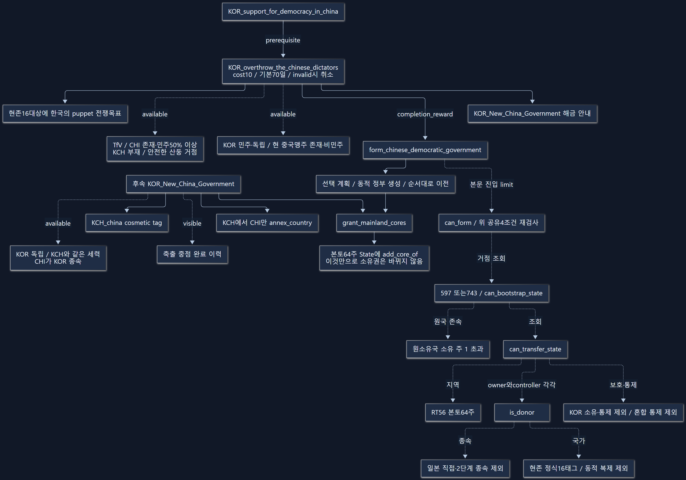
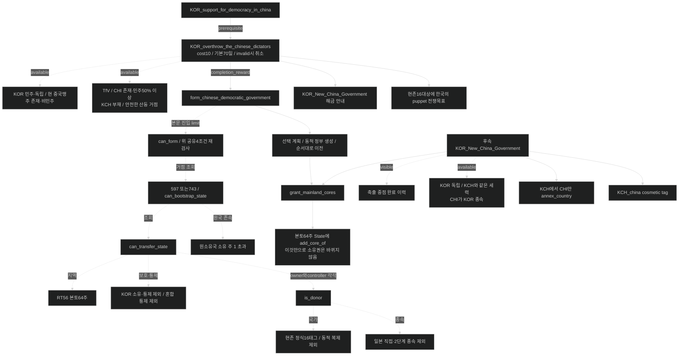
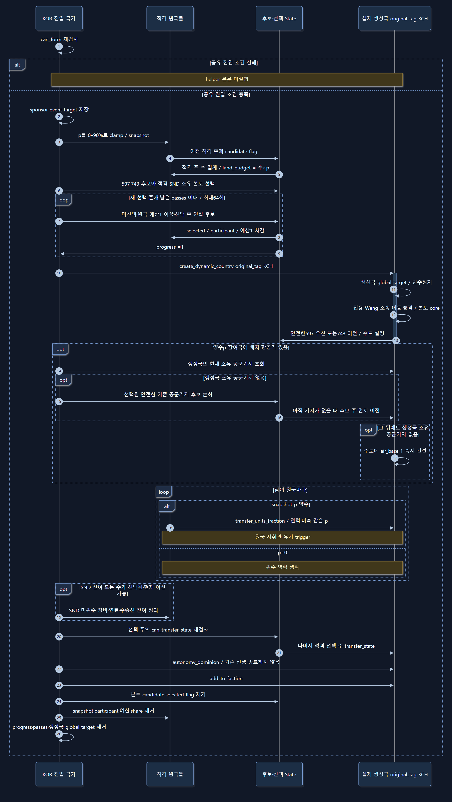
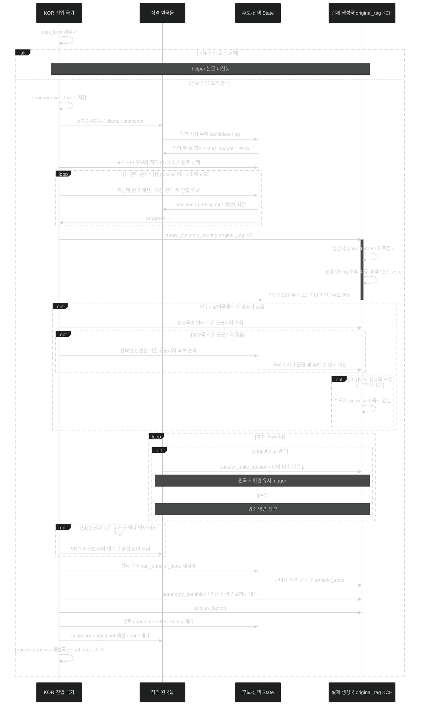
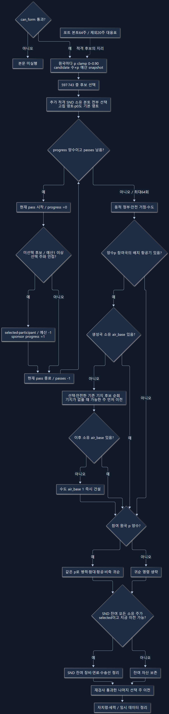
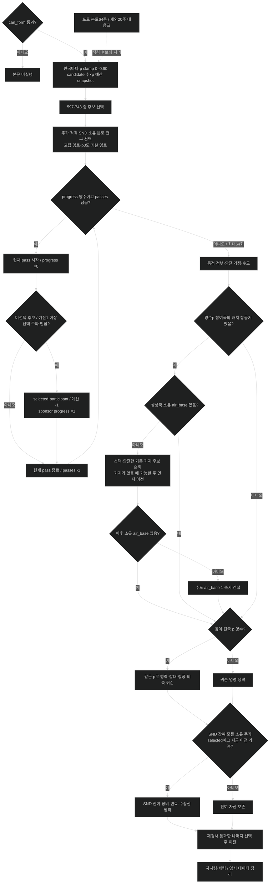
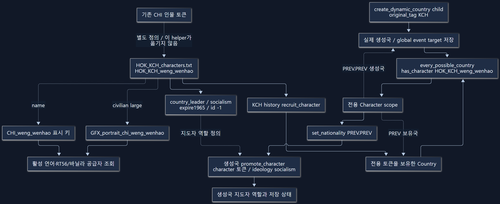
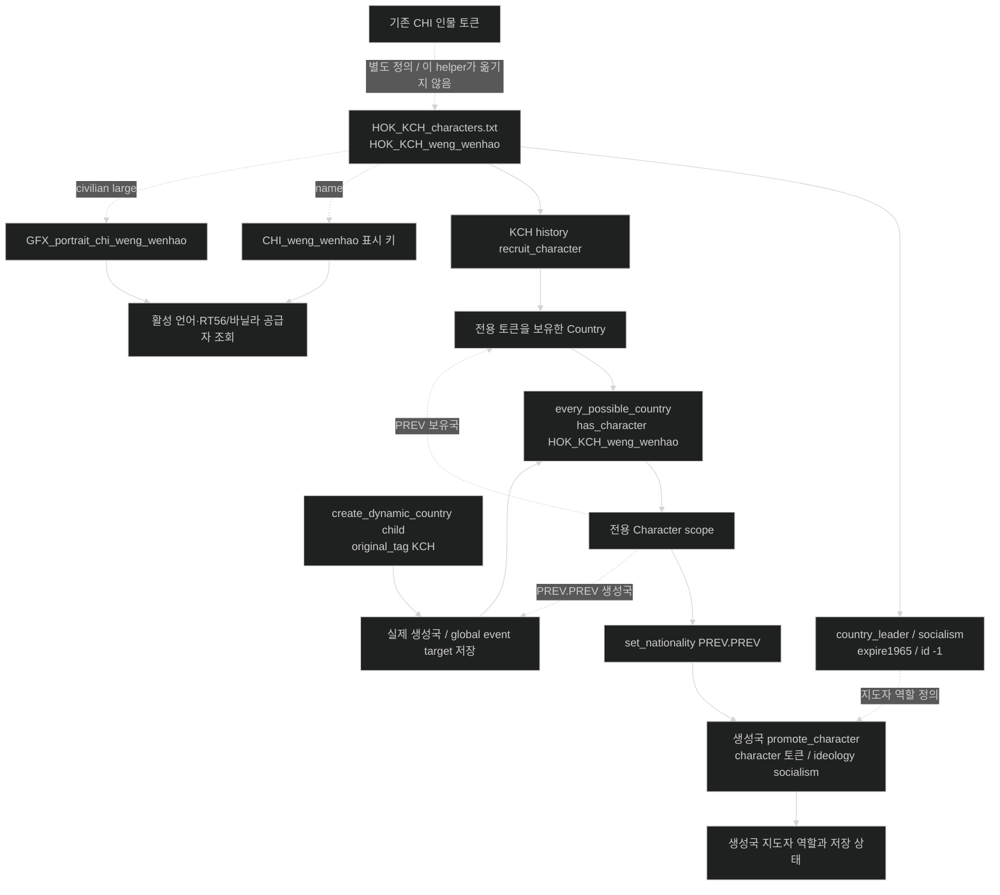

# 산둥 정부의 호출·선택·이전·인물 수명주기

기준: **2026-11-20, Asia/Seoul**. 호환판 `feat/korean-focus-update-20260922@9a01955785bcdd827c9c85522537a0bfc57ed654` 위 현재 미커밋 소스를 읽은 설명이다. 이번은 문서·도표만 상세화한다. 소스의 실행 순서와 이전 실제 관측·미검증을 구분하며 게임을 다시 실행하지 않는다.

[전체 목차](README.md) · [scope](domain-model.md) · [State 이전 상세](states/ownership-and-transfer.md) · [상세화 기록](../implementation/2026-11-20-architecture-detail-expansion.md) · [유지 안내](maintenance.md)

정본은 [출범 효과](../../common/scripted_effects/HOK_KOR_chinese_government_effects.txt), [공유 조건](../../common/scripted_triggers/HOK_KOR_chinese_government_state_triggers.txt), [공유 정식 중국국 필터](../../common/scripted_triggers/HOK_KOR_chinese_democratic_support_triggers.txt), [지리 대응 기록](../implementation/2026-11-20-chinese-government-state-mapping.md)이다. 포트의 본토 집합은 RT56 Gyarong1075를 포함한 64주다. 원본 63주를 번호만 치환한 집합이나 새 지도 재분할이 아니다.

## D15 · 중점·공유 조건·공용 핵심주·후속 인정

실선은 효과 호출·결과, 점선은 조건 조회다. 중점 `available`과 helper 내부 `can_form`은 같은 전체 조건을 중복한 것이 아니다. `unlock_decision_tooltip`은 후속 결정 안내이며 국가 생성 효과가 아니다.

Mermaid 편집 원본

조건의 정확한 경계는 다음과 같다.

| 항목 | 소스 계약 | 구분 |
|---|---|---|
| 중점 진입·유지 | [한국 중점](../../common/national_focus/korea.txt): 민주·독립 KOR, 현 중국맹주 존재·비민주, 공유4조건, `cancel_if_invalid=yes`·`continue_if_invalid=no` | 기본70일을 실제 관측 경과일과 동일시하지 않는다. 한국의 세력 맹주 조건은 제거됐다. |
| helper 재진입 | `can_form`: TfV, CHI 존재·민주 지지도50% 이상, KCH 부재, 안전 거점 | 외부 중점의 모든 정치 조건을 재구현하지 않는다. 이 조건 실패 시 helper 본문은 건너뛴다. 강제로 중점 효과를 호출하는 것은 정상 진행과 별도다. |
| 이전 적격·거점 | 본토·한국 보호·완전통제·적격 owner/controller; 거점은 원국 소유 주 1 초과 추가 | 일반 이전 가능한 마지막 주가 첫 거점으로도 가능하다는 뜻이 아니다. [S08](states/ownership-and-transfer.md#s08-transfer-eligibility)에서 확대한다. |
| 후속 인정 | [한국 결정](../../common/decisions/KOR_decision.txt)의 `KOR_New_China_Government` | CHI만 합병하고 같은 core helper를 호출한다. 모든 군벌 자동 합병·출범 helper 재호출이 아니다. |
| DLC tooltip의 옛 이름 | `HOK_KOR_chinese_government_mtg_tt`라는 안정 키 | 현재 실제 조건은 Together for Victory다. 키 이름에 남은 mtg를 Man the Guns 조건으로 해석하지 않는다. |

## D16 · 한국·원국·생성국의 실제 처리 순서

시퀀스는 효과 파일의 순서를 설명한다. 같은 비율을 입력하는 것과 각 사단·함정·항공기·비축의 실제 결과가 정확히 비례하는 것은 별도다. 생성국의 실제 태그는 고정하지 않는다.

Mermaid 편집 원본

생성 child가 저장한 `HOK_KOR_chinese_democratic_government` global event target은 이후 별도 효과 문맥에서 같은 생성국을 찾는 수단이다. 첫 거점과 먼저 넘길 공군기지는 bootstrap 조건으로 원국의 마지막 주를 보호한다. 뒤의 일반 이전은 각 주의 이전 적격을 다시 검사한다. 따라서 후보 선택 당시의 소유·통제만으로 나중 이전을 확정하지 않는다.

`set_autonomy`는 `end_wars=no`, `end_civil_wars=no`를 명시한다. 세력 연결의 실제 엔진 처리와 한국 비맹주 조합은 [기존 실행 기록](../implementation/2026-11-20-korean-democratic-support-intelligence-port.md)을 따른다. 도표만으로 모든 세력·전쟁·DLC 조합을 지원한다고 판단하지 않는다.

## D17 · 기본 영토·연결 확장·항공기·SND 잔여 분기

실선은 선택 또는 효과의 분기다. 점선은 정본 데이터·조건 조회다. 기본 영토와 지지도 예산을 쓰는 추가 영토는 서로 다른 규칙이다.

Mermaid 편집 원본

- SND의 **소유 본토**만 기본 편입 후보이고, SND core만 있는 타국 영토를 자동 편입하지 않는다. 한국 보호·완전통제·일본 종속 제외 규칙은 SND에도 적용된다.
- 597·743은 candidate일 때 선택한다. 첫 이전은 597의 bootstrap 재검사 결과에 따라597 또는 대안743을 사용하며, 743에는 별도 재검사가 없다. p=0인 기본 영토 선택과 p=0인 전력 이전 생략을 구별한다.
- 연결 확장은 선택 표식에 대한 인접 검사와 원소유국 예산을 사용한다. 적격 SND의 고립 기본 영토도 연결 확장의 출발점이 될 수 있다.
- SND 잔여 정리는 귀순 뒤, 마지막 영토 이전 앞에서만 실행한다. 마지막 주를 먼저 이전하면 자동 승계가 끼어들 수 있다는 보호 계약이다. 다른 원국까지 잔여 정리를 확대하지 않는다.

정확한 본토·제외·seed·RT56 적응의 정본은 [기계 판독 대응표](../data/HOK_KOREAN_CHINESE_GOVERNMENT_RT56_MAPPING.json), [지리 기록](../implementation/2026-11-20-chinese-government-state-mapping.md), [선택 잠금](../../tools/hok_democratic_support_lock.json)이다. 이 도표의 64는 현 입력의 집합·반복 상한이며 미래 RT56 업데이트에도 자동 유효하다는 뜻이 아니다.

## D18 · 전용 웡원하오의 정의·초기 모집·이동·승격·표시

실선은 정의·초기화·런타임 처리, 점선은 이름·초상화나 이전 scope 참조다. 동일한 역사 인물의 기존 CHI 토큰과 새 전용 토큰을 합치지 않는다.

Mermaid 편집 원본

근거: [전용 인물](../../common/characters/HOK_KCH_characters.txt), [KCH 이력](<../../history/countries/KCH - Korean China.txt>), 출범 효과. `id=-1`은 정의에 있는 값이며 저장의 실제 숫자 캐릭터 ID를 약속하지 않는다. 이름·portrait sprite의 실제 공급자와 활성 덮어쓰기는 [표시 경로](presentation-assets.md)를 따른다. 기존 CHI 인물, 동적 국가 태그, 캐릭터 표시 이름을 동일한 식별자로 취급하지 않는다.

기출범 저장의 지도자를 자동 교체하거나 history를 소급 재실행하는 새 처리는 이 상세화에 없다. 새 모집·국적 이동·승격·표시·저장 복원을 각각 구분한다. 일본 비맹주 초대의 `PREV.PREV`는 이 인물 이동과 다른 호출 사슬이며 [D04](domain-model.md#d04-scope-context)를 따른다.

## 처리·증거·갱신 계약

| 후보 | 처리 | 현재 설명과 확인 경계 |
|---|---|---|
| D15 호출·공유 조건 | **문서 수정** | 중점 가용·helper 재검사·공통 core·후속 인정·별도 전쟁목표를 분리했다. |
| D16/D17 순서·분기 | **문서 수정** | 이관 전 snapshot, 기본/추가 영토, 공군기지 대안, 양수p 귀순, SND 잔여 정리, 마지막 영토 이전·정리까지 연결했다. |
| D18 인물 | **문서 수정** | 초기 정의·모집, 현재 보유국 조회, Character scope 이동과 생성국 승격을 분리했다. |
| 본토64·seed597/743·보호 규칙·p·stable ID·원국 지휘관 유지 | **의도적 유지** | 실제 포트 입력과 코드의 현재 계약을 설명한다. 새 지리·비율·DLC·자치 등급을 설계하지 않는다. |
| 원본63주 숫자 복사·CHI 기존 지도자 이동·동적 태그 고정·다른 원국 잔여 정리 | **제외** | 현재 소스와 포트 지리·인물·소유권 계약에 해당하지 않는다. |
| 엔진의 세부 자산 배분·소멸·모든 세력/전쟁/DLC 조합·기존 저장 | **미확인 또는 기존 실행 범위** | 소스와 그림만으로 보증하지 않는다. 아래 실제 실행 기록의 구성과 한정된 결과를 유지한다. |

[전체 이식 기록](../implementation/2026-11-20-korean-democratic-support-intelligence-port.md)은 CHI 경계값, 0%/양수 귀순, 보호 영토, 새 저장, 일본 비맹주 실패와 수선 후 결과, 중국 비맹주 사례 및 남은 미검증을 분리한다. 과거 원본 실행, 강제 효과, 정상 진행, 소스 읽기, 이번 그림 렌더링을 서로 합산하지 않는다. 호출·보호·선택·자산·인물 관계가 바뀌면 D15–18과 S07–09의 관련 정본을 함께 갱신한다.
