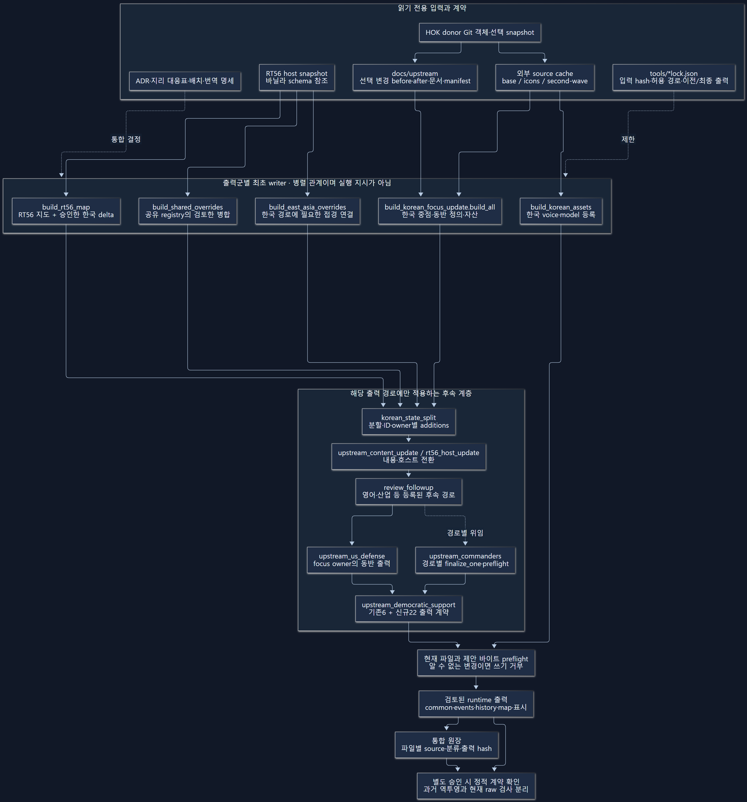
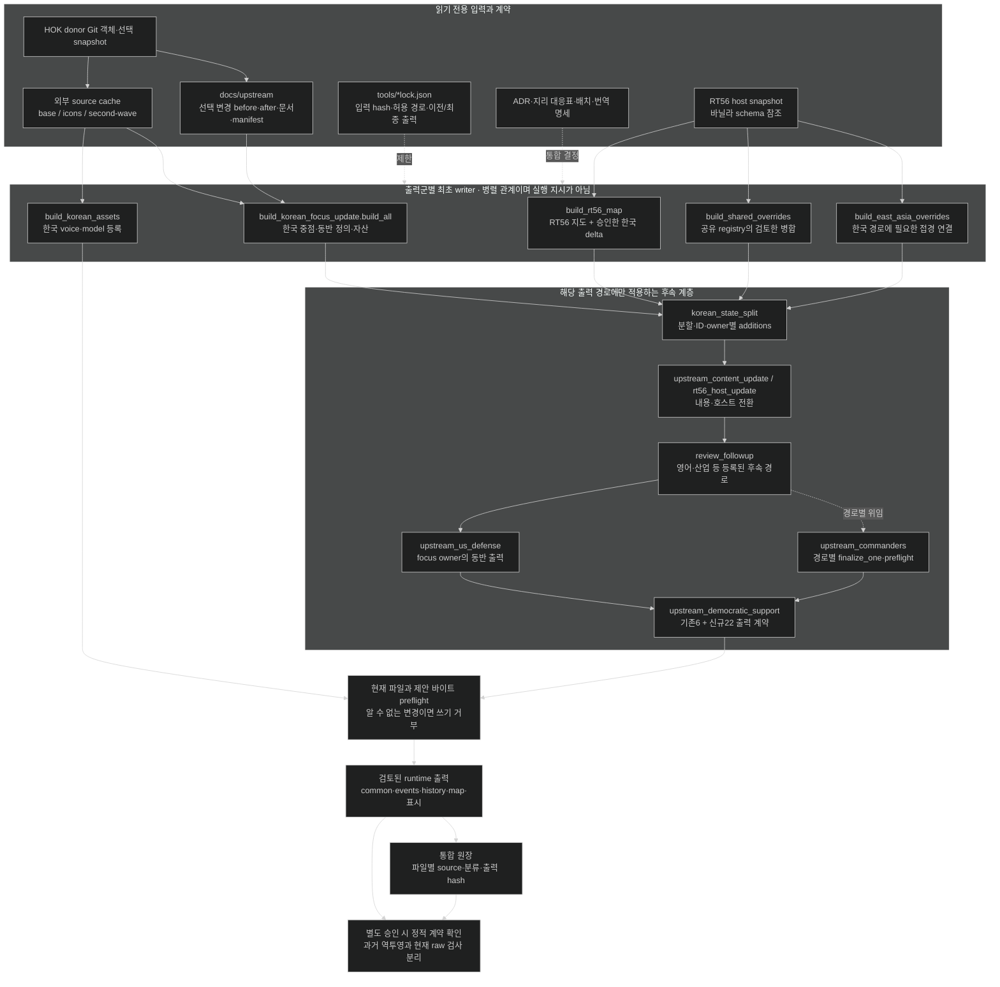
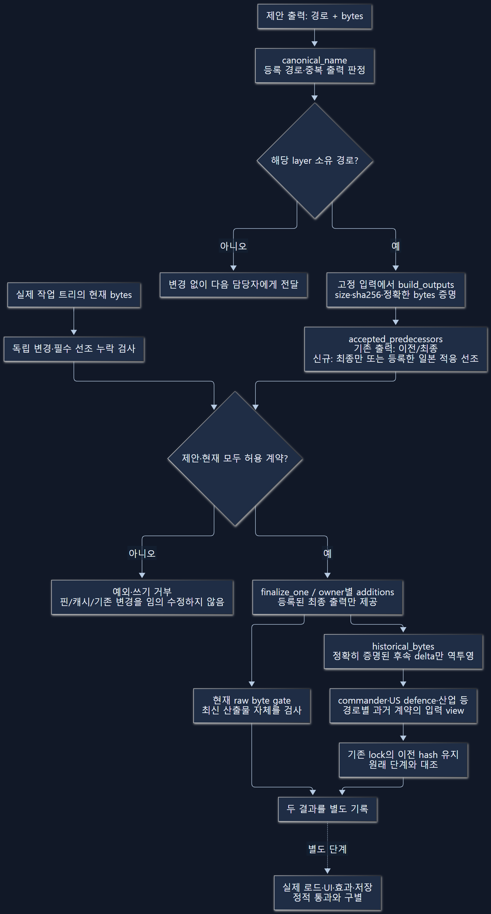
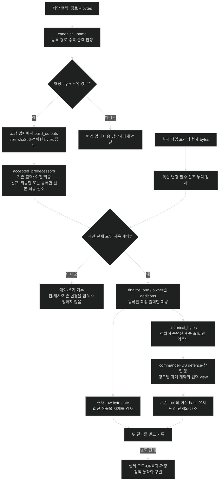
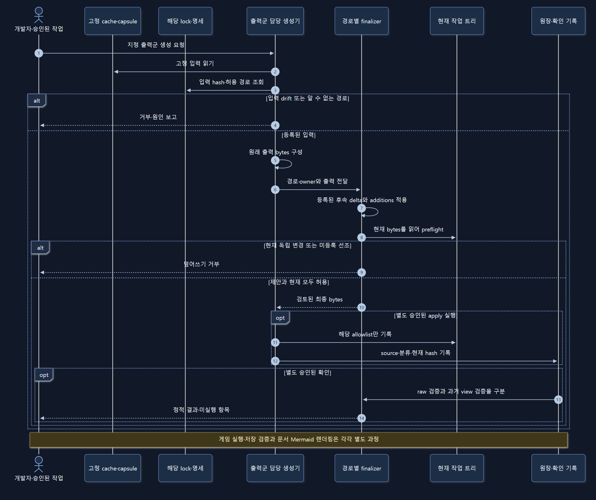
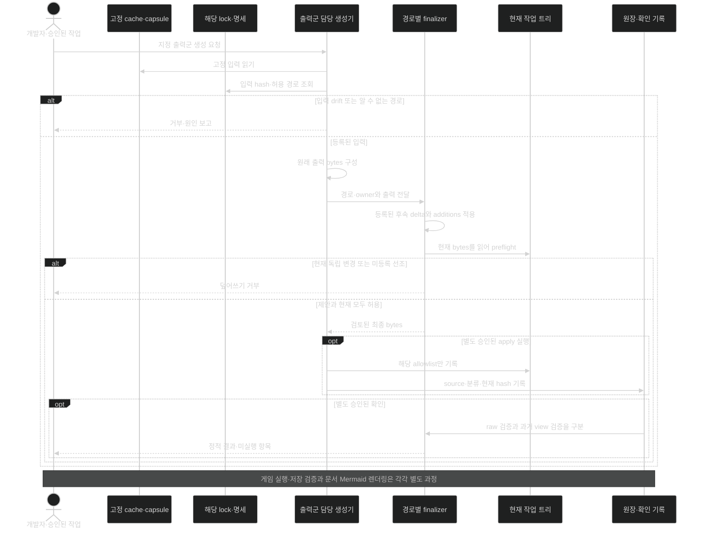

# 고정 입력과 생성 출력의 소유권

기준: **2026-11-20, Asia/Seoul**. 호환판 `9a01955785bcdd827c9c85522537a0bfc57ed654` 위 현재 미커밋 작업 트리의 소스 설명이다. 이번 작업은 문서·도표만 상세화한다. 게임 로드·UI·효과·저장은 기존 기록의 소스·조건에 한정하며 새로 실행하지 않았다. [상세화 기록](../implementation/2026-11-20-architecture-detail-expansion.md).

[전체 목차](README.md) · [유지·갱신 안내](maintenance.md) · [문서 인덱스](../README.md)

이 페이지는 개발 도구의 관계다. HOI4는 Python 생성기를 실행하지 않는다. 원본 물리 파일, 고정 사본, 메모리 중간 출력, runtime 최종 출력의 해시는 서로 다른 역할이다.

## D08 · 입력에서 runtime과 원장까지

화살표는 개발 생성 경로이며 게임 내 실행 순서가 아니다. 개별 생성기는 각자 소유한 출력만 만든다.

Mermaid 편집 원본

근거: [source_snapshot.py](../../tools/source_snapshot.py)의 `SOURCE_CACHE_ROOT`, [분할 계층](../../tools/korean_state_split.py)의 `finalize_outputs`, [후속 계층](../../tools/review_followup.py), [지휘관 계층](../../tools/upstream_commanders.py), [통합 원장 생성기](../../tools/build_integration_manifest.py). 활성 입력은 `C:/hoi/test/hok-rt56-source-cache/sources/`이며 새 렌더·시험 출력 위치가 아니다. [경로와 보관 역할](../HOK_DEVELOPMENT_ARTIFACT_ARCHIVE.md)을 먼저 읽고 입력을 사용한다.

## D20 · 최종 바이트 검사와 과거 계약의 역투영

최종 출력 검증과 과거 입력 계약은 별개다. 역투영은 임의 변경을 허용하기 위한 해시 면제가 아니다.

Mermaid 편집 원본

구체적 구현은 `historical_bytes`, `finalize_one`, `preflight_outputs`를 읽는다. 지휘관의 [생성 소유권 기록](../implementation/2026-11-14-korean-commander-unlock-port.md)은 이전 writer 전환과 전체 원장 생성 실패를 구분한다. 새 [민주 지원 계층](../../tools/upstream_democratic_support.py)과 [잠금](../../tools/hok_democratic_support_lock.json)은 현재28출력을 소유하며 `upstream_commanders`의 역투영/최종화/preflight와 `upstream_us_defense.finalize_outputs`의 중점 경로에 연결된다. 실제 함수의 경로별 처리를 확인하며 모든 생성기가 동일한 단일 경로를 거친다고 가정하지 않는다. 과거 aggregate 실패를 도표 작성 때문에 해결됐다고 기록하지 않는다.

## 출력군과 실제 위임 계약

D08의 큰 계층은 읽기 안내다. `korean_state_split.finalize_outputs`의 bulk 위임은 **split → content → review → US defence → democracy**다. `upstream_commanders`는 경로별 `finalize_one`·역투영·preflight 위임에 참여하며, bulk 호출마다 지휘관 전체 CLI가 실행된다는 의미가 아니다. `owner`는 게임 국가가 아니라 개발 writer 이름이다.

| 코드·계약 | 구체적 역할 | 의도적 구분 |
|---|---|---|
| [source_snapshot](../../tools/source_snapshot.py) | 감사된 base/icons/second-wave 입력과 선택 업데이트를 읽음 | 현재 donor 폴더 전체를 매번 복사하지 않음 |
| [focus build_all](../../tools/build_korean_focus_update.py) | 한국 중점 관련 출력을 만들고 `owner="focus"`로 최종화 | 신규 정의·이미지의 owner-scoped additions 포함 |
| [지도](../../tools/build_rt56_map.py), [공유](../../tools/build_shared_overrides.py), [접경](../../tools/build_east_asia_overrides.py), [한국 자산](../../tools/build_korean_assets.py) | 서로 다른 출력군과 RT56 병합 책임 | 모든 writer가 동일한 경로·CLI를 사용하지 않음 |
| [split finalize_outputs](../../tools/korean_state_split.py) | focus의 주 이름 파일, map의 새 State, east-asia의 일본 중점 등 owner별 추가 | State ID 이전과 현재 중국 참조 정렬을 구분 |
| [review](../../tools/review_followup.py), [영어 용어](../../tools/english_terminology.py) | 정해진 경로·바이트만 다음 계층으로 보냄 | 모르는 현재 변경은 계약에 추가하지 않고 거부 |
| [US defence](../../tools/upstream_us_defense.py), [commanders](../../tools/upstream_commanders.py), [democracy](../../tools/upstream_democratic_support.py) | 등록된 최신 출력 보존·역투영·최종화 | `historical_bytes`는 디스크를 과거 파일로 되돌리는 명령이 아님 |
| [통합 원장](../../tools/build_integration_manifest.py) | source·분류·현재 출력·역사 계약을 기록 | 전체 원장 재생성은 이번 문서 작업에서 실행하지 않음 |

## D22 · 개발 생성·거부·문서 갱신의 시퀀스

개발자가 별도로 승인한 생성 작업의 소스 계약을 설명한다. 이번 문서 상세화가 생성기를 실행했다는 뜻은 아니다. 실제로 실행한 것은 문서 렌더링뿐이며 경로는 [상세화 기록](../implementation/2026-11-20-architecture-detail-expansion.md)에 남긴다.

Mermaid 편집 원본

## 처리·근거와 갱신 조건

| 후보 | 처리 | 근거와 한계 |
|---|---|---|
| D08의 단일 생성기 상자 | 수정 | 실제 writer·입력 역할·owner additions·bulk 위임을 드러냄 |
| D20의 단일 hash 판정 | 수정 | 제안/현재/최종/역사 view와 거부를 나눔. 경로별 코드가 정본 |
| D22 생성 순서 | 수정 | 새 설명 시퀀스. 실행 기록이 아니라 함수 소스의 계약 |
| immutable source pins·외부 cache 역할 | 의도적 유지 | 입력 해시·캐시·runtime·원장을 변경하지 않음 |
| 과거 aggregate 오류·게임 1.20 전면 호환 | 제외 | 이번 작업으로 해결·입증하지 않음. 최신 콘텐츠 기록의 기존 제한 유지 |

실선은 개발 데이터 전달·호출, 점선은 제한·정책·별도 검증 연결이다. 새 writer/후속 계층/경로 소유권이 바뀌면 D08/D20/D22와 이 표를 함께 대조한다.

