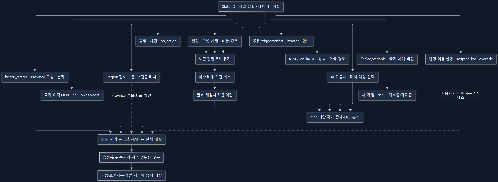
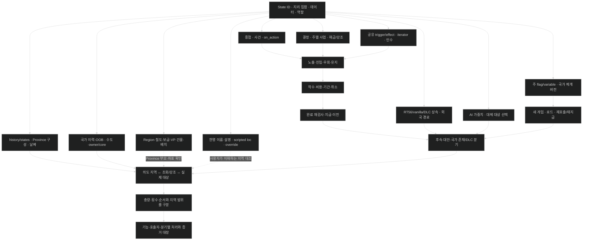
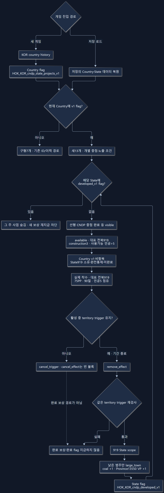
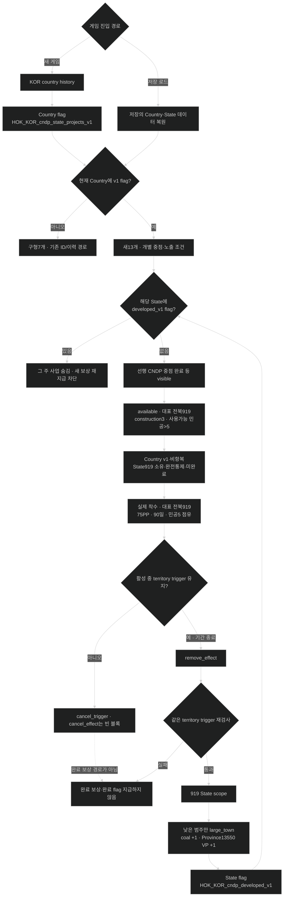
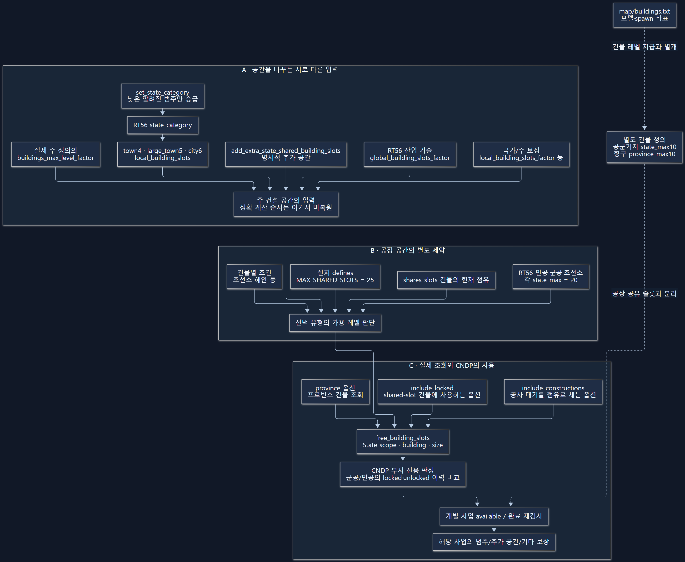
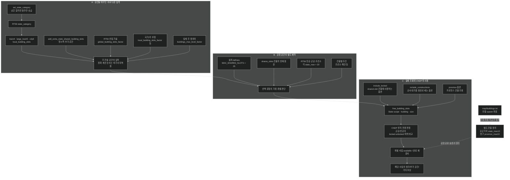

# 주 변경의 소비자·저장·건설 공간

기준: **2026-11-20, Asia/Seoul**. 호환판 `9a01955785bcdd827c9c85522537a0bfc57ed654` 위 **현재 미커밋 통합 소스**를 읽은 설명이다. 이번 후속은 S10–S12의 문서·도표 상세화다. 소비자·표식·보상·건설 정의를 바꾸거나 게임/검증기를 실행하지 않았다. [이번 상세화 기록](../../implementation/2026-11-20-architecture-detail-expansion.md)과 각 과거 구현 기록의 증거를 구분한다.

[State 목차](README.md) · [정의와 scope](definition-and-scope.md) · [지도와 분할](geography-and-splits.md) · [소유와 이전](ownership-and-transfer.md) · [유지·갱신 안내](../maintenance.md)

상태 표식의 소유 scope, 새/옛 사업 경로, 건설 공간과 실제 건물 지급은 서로 다르다. 설치·RT56 정의를 읽었다는 사실을 모든 활성 모드의 최종값·실제 건설 UI·장기 저장 호환 확인으로 바꾸지 않는다.

## S10 · 주 데이터의 영향 범위

실선은 **추적할 참조·소비 관계**, 점선은 의미·위치의 재대조다. 모든 기능이 모든 파일을 반드시 사용한다는 뜻은 아니다. 고정 ID 검색은 출발점이며 iterator·scripted parameter·변수·event target·상속 정의를 함께 읽는다.

Mermaid 편집 원본

| 실제 접점 | 읽을 소스·결정 | 이번 문서에서 구분한 의미 |
|---|---|---|
| CNDP 주별 사업 | [결정](../../../common/decisions/KOR_decision.txt), [공유 trigger](../../../common/scripted_triggers/HOK_KOR_cndp_triggers.txt), [ADR-0007](../../decisions/0007-november-content-integration.md) | visible·available·취소·remove_effect 재검사·State 완료 flag를 함께 추적한다. |
| 산둥 출범·인정 | [출범 효과](../../../common/scripted_effects/HOK_KOR_chinese_government_effects.txt), [State 조건](../../../common/scripted_triggers/HOK_KOR_chinese_government_state_triggers.txt), [본토 대응표](../../data/HOK_KOREAN_CHINESE_GOVERNMENT_RT56_MAPPING.json) | 한국15주와 중국 본토64주를 섞지 않는다. 선택·owner 예산·최종 이전·CHI 인정은 별개다. [S07–S09](ownership-and-transfer.md)를 따른다. |
| 한국·외국 연결 | [한국 중점](../../../common/national_focus/korea.txt), [한국 사건](../../../events/korea.txt), [ADR-0006](../../decisions/0006-korean-state-split-integration.md)·[0007](../../decisions/0007-november-content-integration.md) | 옛 도 전체 조건, 단일 도시/시설 보상, 외국 RT56 부모 주를 구분한다. 일반 JAP/CHI 콘텐츠 전체를 donor 소유로 만들지 않는다. |
| 수도·인물 | [KOR 이력](<../../../history/countries/KOR - Korea.txt>), [KCH 이력](<../../../history/countries/KCH - Korean China.txt>), [D18](../shandong-government.md#d18-character-lifecycle) | 수도의 State 입력과 전용 캐릭터 등록·실제 국적 이전을 구분한다. |
| 지도·배치·승점 | [주 정의](../../../history/states/), [지도 생성기](../../../tools/build_rt56_map.py), [S04–S06](geography-and-splits.md) | State ID·Province ID·표시 키·좌표를 구분한다. 전수 지리 검증을 수행했다는 뜻은 아니다. |
| 표시·활성 번역 | [표시 문서](../presentation-assets.md), [언어 ADR](../../decisions/0003-localisation-contract.md), [현지화 스킬](../../skills/hok-rt56-localisation-review/SKILL.md) | 이름이 맞아도 대상의 지리나 실제 유효 로드 우선순위를 입증하지 않는다. |

기존 ID 하나에 보상을 남기는 정책, 옛 도 전체 조건을 두 후속 주로 확대하는 정책, 새 주의 독립 사업은 서로 다른 설계다. 최초 분할의 총량 보존을 후속 승인 산업 변경까지 거슬러 적용하지 않는다. [최신 산업 기록](../../implementation/2026-11-10-korean-industry-update-port.md)과 해당 소유 계층을 읽는다.

## S11 · 국가 버전 표식과 주별 완료 표식

현재 CNDP의 **새13개/구형7개 경로와 대표 전북919 사업**이다. 화살표는 저장 데이터·조건 분기·결정 수명 관계다. 엔진 이벤트 큐의 정확한 순서나 모든 사업의 같은 비용·보상을 뜻하지 않는다.

Mermaid 편집 원본

| 데이터·분기 | 실제 소스와 의미 |
|---|---|
| 국가의 체계 버전 | [KOR 이력](<../../../history/countries/KOR - Korea.txt>)의 country flag다. 변경 전 저장에 새 history 표식이 자동 소급된다고 하지 않는다. |
| 새13개 | [CNDP 결정](../../../common/decisions/KOR_decision.txt)의 전북·전남·경북·경남·충남·충북·황남·황북·평남·평북·함남·함북·강원이다. 한국15주 전체와 같지 않으며 경기·제주 사업을 이 버전에 새로 만들어 넣지 않는다. |
| 구형7개 | KOR_develop_jeolla/gyeongsang/chungcheong/hwanghae/pyeongan/gangwon/hamgyeong의 기존 ID와 v1 부재 경로를 유지한다. 기존 보상 이력을 추정해 새 주에 다시 지급하는 변환이 아니다. |
| 해당 주의 완료 표식 | [공유 territory trigger](../../../common/scripted_triggers/HOK_KOR_cndp_triggers.txt)는 State의 developed_v1 부재를 검사한다. 한 주의 flag로 다른 주·다른 버전까지 완료됐다고 추정하지 않는다. |
| 착수·취소·완료 | 대표919는 같은 territory trigger를 available·cancel_trigger·remove_effect 재검사에 사용한다. 취소를 기간 만료 보상으로 그리지 않는다. complete_effect가 항상 기간 종료 보상이라고 일반화하지 않는다. |
| 보상과 slot | 대표919는 범주·coal·승점을 지급한다. 인접 전남1150의 추가 shared slot+1과 같은 보상이 아니다. 표의75PP/90일/민공5는 이 대표 사업의 소스다. |
| 저장 범위 | [11월8일 구현 기록](../../implementation/2026-11-08-hok-upstream-content-port.md)의 실제 관측을 따른다. [ADR-0006](../../decisions/0006-korean-state-split-integration.md)의 새15주 지도 저장 재로드와 **이전9주 지도 저장 변환**은 다르다. |

지휘관의 별도 country flag는 [D19](../commander-unlock.md)에서 설명한다. CNDP guard를 지휘관·과학자·첩보원의 모든 구 저장 초기화 문제를 해결하는 일반 마이그레이션으로 설명하지 않는다.

## S12 · 기본 공간·추가 슬롯·공유/유형별 상한

아래는 **확인한 실제 입력·제약·조회 관계**다. 화살표는 의존 관계이며 정확한 덧셈·곱셈·반올림·보정 적용 순서를 복원한 산식이 아니다. 점선은 별도 건물 종류나 공간과 독립된 배치 관계다.

Mermaid 편집 원본

### 읽은 원본과 실제 수치의 범위

설치 루트는 `C:/Program Files (x86)/Steam/steamapps/common/Hearts of Iron IV`, RT56 루트는 `C:/Program Files (x86)/Steam/steamapps/workshop/content/394360/820260968`다. 설치 launcher-settings.json은 **Operation Postern v1.20.0.0.8873 (0c4f)**를 표시한다. 이 설치 메타데이터는 실행 체크섬이나 전체1.20 호환 판정이 아니다.

| 입력·계약 | 이번에 읽은 실제 정의 | 적용·한계 |
|---|---|---|
| 범주 기본 공간 | RT56 common/state_category/town.txt·large_town.txt·city.txt의 local_building_slots=4·5·6 | 설치 vanilla의 같은 세 값도4·5·6이지만 포트의 호스트는 RT56이다. 범주 승급과 추가 슬롯은 별도 효과다. |
| 호스트 고유 범주 | RT56 common/state_category/developed_rural.txt는3 | 현재 CNDP의 below_town/large_town/city/large_city 목록에는 이 토큰이 없다. 알려진 낮은 범주만 허용하는 현행 코드를 문서에 맞춰 확대하지 않았다. 이 범주의 정상 사업 진행·의도는 별도 확인 대상이다. |
| 명시적 추가 공간 | 설치 documentation/effects_documentation.md의 add_extra_state_shared_building_slots, 실제 [전남1150 사업](../../../common/decisions/KOR_decision.txt) | State scope의 추가 shared slot이다. 즉시 공장을 주거나 유형별 상한을 제거하는 명령이 아니다. |
| 공유 상한 | 설치 common/defines/00_defines.lua의 MAX_SHARED_SLOTS=25 | 읽은 RT56 common/defines에는 이 이름의 재정의가 없고 포트에 해당 defines 디렉터리는 없다. 다른 모든 외부 모드·미래 구성의 불변값이라는 뜻은 아니다. |
| 공장 유형별 상한 | RT56 common/buildings/00_buildings.txt의 industrial_complex·arms_factory·dockyard는 shares_slots=yes, state_max=20 | 공유25와 유형별20은 동시에 고려할 다른 제약이다. dockyard에는 only_costal=yes도 있다. 원본의 철자를 바꾸거나 공통 제약을 수정하지 않는다. |
| 다른 건물 | 같은 RT56 파일의 air_base state_max10, naval_base province_max10·only_costal=yes | 항구·공군기지를 공장 shared slot과 같은 종류로 설명하지 않는다. |
| 기술·보정 | RT56 common/technologies/industry.txt의 global_building_slots_factor, 포트 [만주 보정](../../../common/dynamic_modifiers/HOK_KOR_manchurian_followup.txt)의 local_building_slots_factor | 적용 대상·해금 여부·여러 보정의 최종 결합은 현재 국가/주/기술 상태를 더 읽어야 한다. 소스에 값이 존재하는 것만으로 모든 주에 적용된다고 하지 않는다. |
| free_building_slots | 설치 documentation/triggers_documentation.md:2936 이하 | State scope이며 building·size 비교를 사용한다. include_locked는 shared-slot 건물용, include_constructions는 대기 공사를 점유로 세는 선택 옵션, province는 프로빈스 건물 조회용이다. |
| CNDP의 실제 옵션 | [CNDP trigger](../../../common/scripted_triggers/HOK_KOR_cndp_triggers.txt)의 has_factory_expansion_room | 군공/민공의 size>0…19와 include_locked=yes/no를 비교하는 보수적 OR다. 이 helper에는 include_constructions·province 옵션이 명시되지 않았다. 문서의 옵션 설명을 실제 호출로 오해하지 않는다. |
| 지역 범주 계수 | [917](../../../history/states/917-Hwanghae.txt)·[525](<../../../history/states/525-South Korea.txt>)의 buildings_max_level_factor=1.000 | 현재 입력을 표시한 것이며 이 값의 엔진 내부 적용 순서나 정확 계산식을 새로 입증하지 않았다. |
| 포트의 건물 소유권 | 포트 common/buildings에는 [HOK 랜드마크](../../../common/buildings/02_landmark_buildings_HoK.txt)가 있다. | 포트가 RT56의 공장 세 유형이나 공유25를 새로 정의하는 것으로 그리지 않는다. [ADR-0004](../../decisions/0004-hok-korean-content-priority.md)의 소유권을 따른다. |

CNDP 부지 전용 사업의 판정은 **정확한 빈 공유 슬롯 getter가 아니다**. [ADR-0007](../../decisions/0007-november-content-integration.md)이 기록한 저점유20–24칸 차단 가능성 등 보수적 한계를 유지한다. 공장별20, 전체 공유25, 범주가 여는 공간, locked 조회 차이를 같은 수치로 합치지 않는다. 도표에서 include_locked·include_constructions의 생략 기본값이나 보정 반올림을 추정하지도 않는다.

건설 공간의 증가, 즉시 공장 지급, 항구 레벨, 지도 모델 배치는 각각 다른 변경이다. 정확한 UI 가용량·초과 지급·공사 대기·DLC/외부 모드의 최종 상한은 이번 문서 작업에서 실행하지 않았다.

## 근거·누락 범위와 처리 대장

HOK 원본의 [변경 영향 문서](../../../../hearts_of_korea/docs/architecture/states/change-impact.md)는 소비자·저장·슬롯을 구분한 설명의 출처다. 이 문서는 실제 포트의13/7 사업·919 보상·RT56 정의·설치1.20 명령 문서를 읽어 작성했다. 원본의1.19.5 수치를 검증 없이 현재 값으로 복제하지 않았다.

| 기능·후보 | 처리 | 이번 확인과 남은 범위 |
|---|---|---|
| S10 참조·수명 단계·상속 소비자 | **수정** | 현행 실제 소비자와 기능별 의미·대조 단계를 확장했다. 작은 변경마다 세계 전체 감사가 필요하다는 규칙은 아니다. |
| S11 국가 버전·주 완료·착수/취소/만료 | **수정** | 실제13/7 경로와 대표919의 조건·수치·remove_effect를 구분했다. 기존9주 저장 이관으로 설명하지 않는다. |
| S12 범주·추가 공간·공유/유형 상한·조회 | **수정** | 실제 RT56와 설치 정의·현재 helper 옵션을 나누고 source 한계를 기록했다. |
| 보상·국가/주 flag·구형 결정 ID·상한 | **의도적 유지** | 실제 script·defines·건물·기술·런타임·잠금은 변경하지 않았다. |
| 전수 소비자 감사·새 슬롯 API·사업 수선·게임 실행 | **제외** | 문서 상세화만 승인된 이번 범위 밖이다. |
| 모든 활성 모드의 최종 상한·보정 산식·developed_rural 사업·이전 저장 | **미확인** | 동적 상태와 실제 UI/효과/저장은 별도 관측이 필요하다. 기존 실행은 연결된 구현 기록의 시점·조건에 한정한다. |

[변경 영향 절차](../../HOK_CHANGE_COVERAGE_REVIEW.md) · [주 참조 스킬](../../skills/hok-rt56-state-reference-review/SKILL.md) · [현지화 스킬](../../skills/hok-rt56-localisation-review/SKILL.md)

