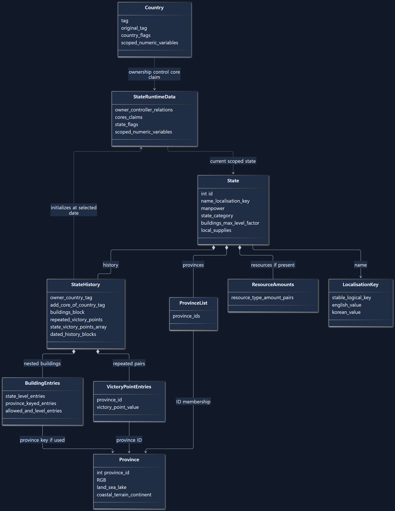
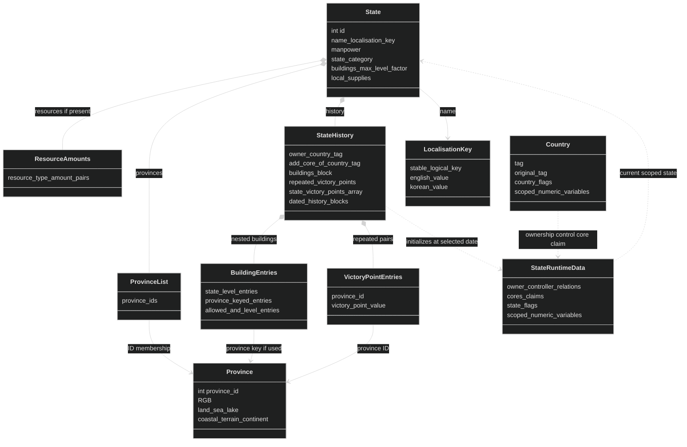
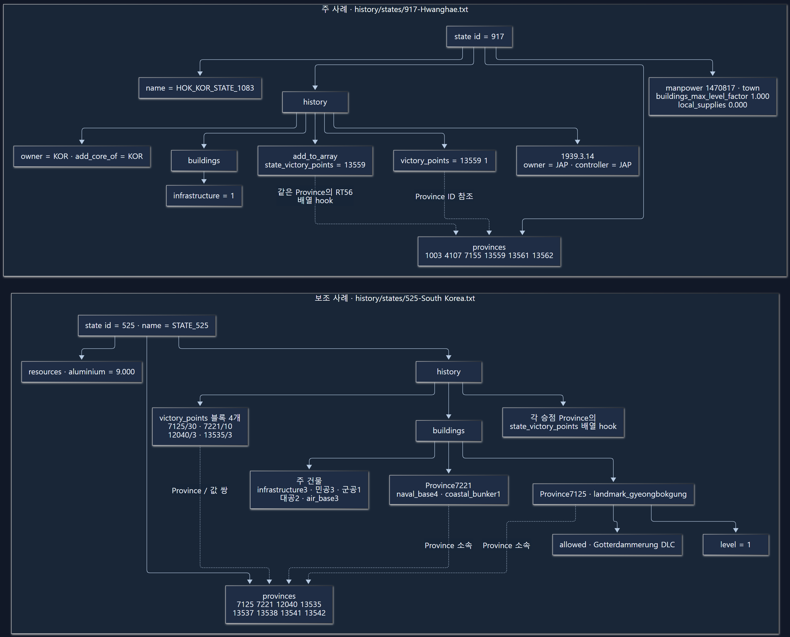
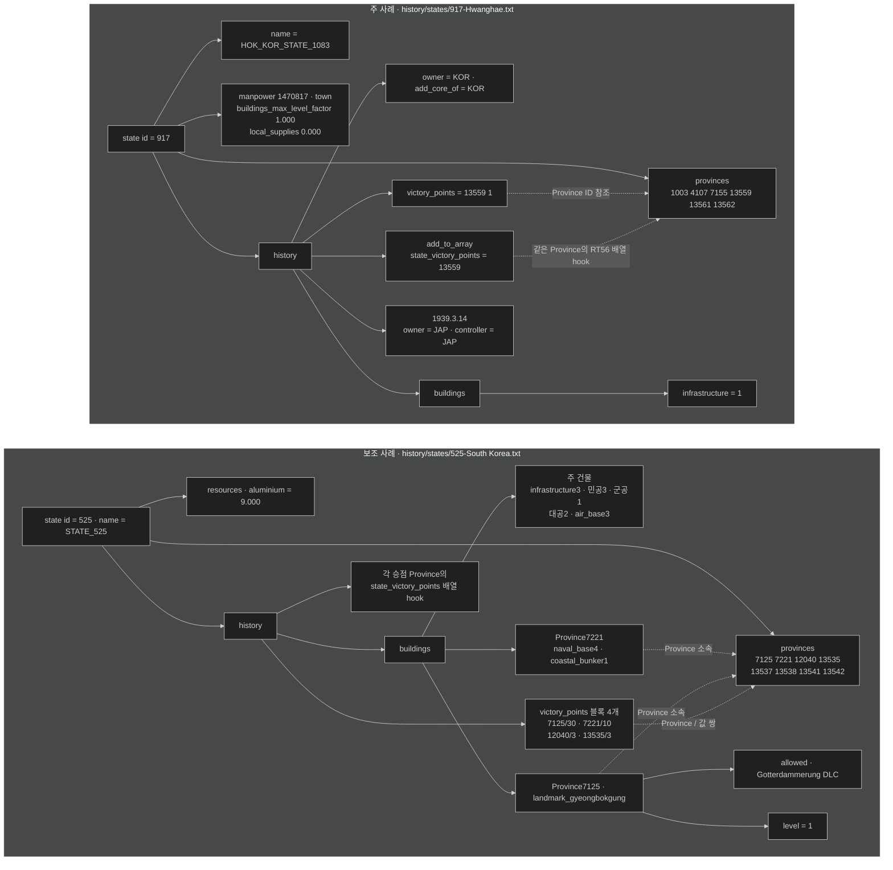
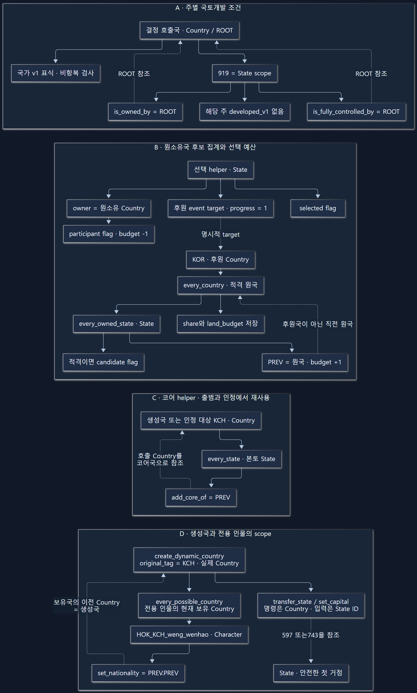
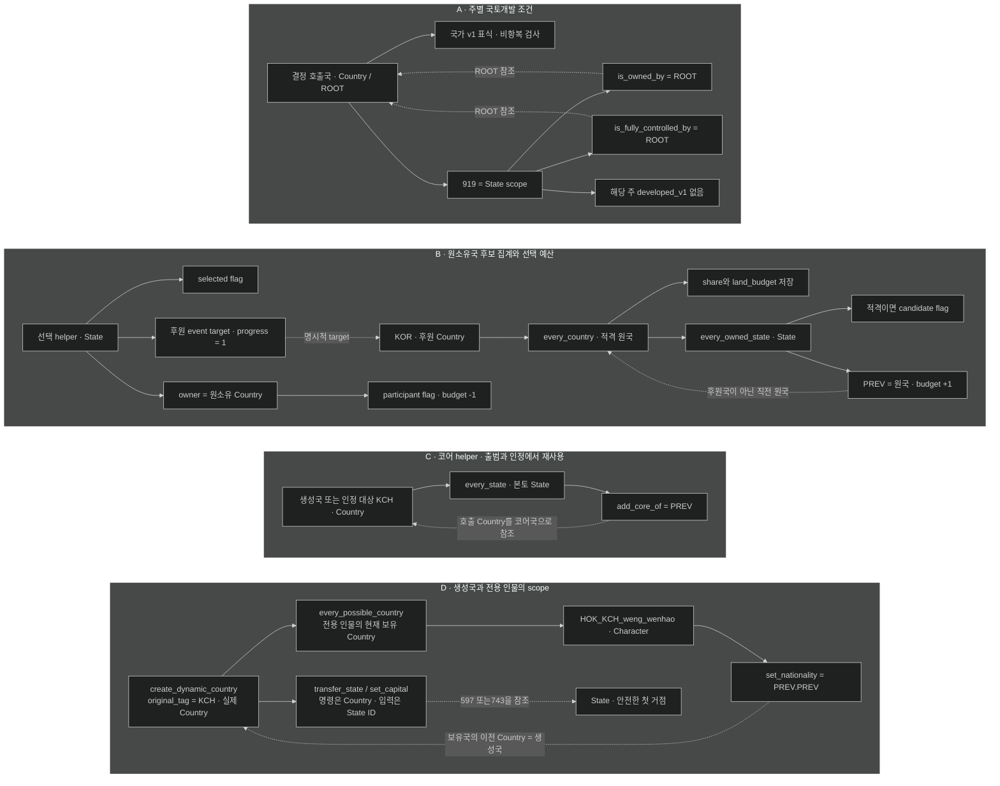

# State 정의·ID·scope

기준: **2026-11-20, Asia/Seoul**. 호환판 `9a01955785bcdd827c9c85522537a0bfc57ed654` 위 **현재 미커밋 통합 소스**를 읽은 설명이다. 이번 후속은 S01–S03의 문서·도표 상세화다. 지도·스크립트·표시 문자열을 바꾸거나 게임을 새로 실행하지 않았다. [이번 상세화 기록](../../implementation/2026-11-20-architecture-detail-expansion.md)과 [기존 콘텐츠 구현 기록](../../implementation/2026-11-20-korean-democratic-support-intelligence-port.md)의 확인 범위를 구분한다.

[State 목차](README.md) · [전체 목차](../README.md) · [지도와 분할](geography-and-splits.md) · [소유와 이전](ownership-and-transfer.md) · [유지·갱신 안내](../maintenance.md)

State는 지리 객체다. 일반적인 상태 머신의 state와 구분한다. 아래 개념도는 엔진 내부 클래스나 메모리 구조를 복원한 것이 아니다. Mermaid가 편집 정본이며 PNG/SVG는 그 파생물이다. 렌더 확인은 게임의 등록·UI·실행·저장 확인과 별개다.

## S01 · 주 데이터와 국가·프로빈스 관계

실선은 소스 데이터의 구성·참조, 점선은 초기화 또는 런타임 사용 관계다. 초기 이력과 진행 중 값을 한 덩어리로 취급하지 않는다. owner/controller/core/claim의 관계와 개수는 [S07](ownership-and-transfer.md#s07-country-state-relations)에서 설명한다.

Mermaid 편집 원본

| 묶음 | 현재 소스의 구체적인 예 | 읽는 방법 |
|---|---|---|
| 기본 정의 | [황해남917](../../../history/states/917-Hwanghae.txt): `manpower=1470817`, `state_category=town`, `buildings_max_level_factor=1.000`, `local_supplies=0.000` | 인구·범주·계수는 서로 다른 입력이다. 건설 가능량의 정확한 산식은 [S12](change-impact.md#s12-building-space)의 주장 범위 밖이다. |
| 지리 집합 | 917의 `provinces={1003 4107 7155 13559 13561 13562}` | State ID나 승점 값의 목록이 아니다. 색·종류는 [definition](../../../map/definition.csv)에서 연결된다. |
| 자원 | 917에는 `resources`가 없고 [경기525](<../../../history/states/525-South Korea.txt>)에는 `aluminium=9.000`이 있다. | 없는 자원을 대표 사례에 만들어 넣지 않는다. 자원은 건물 레벨과도 구분한다. |
| 시작·날짜 이력 | 917의 `owner=KOR`, `add_core_of=KOR`, `1939.3.14={owner=JAP controller=JAP}` | 실제 플레이 중 owner/controller나 지원되는 bookmark의 증거로 바꾸지 않는다. |
| 건물·승점 | 525의 주 단위 공장·공군기지, Province7221 항구, Province7125 조건부 랜드마크, 반복 승점 | 같은 history 아래 있어도 입력 종류와 중첩이 다르다. S02에서 분리한다. |
| 런타임 표식 | 주의 `HOK_KOR_cndp_developed_v1`와 국가의 `HOK_KOR_cndp_state_projects_v1` | 이름이 비슷해도 저장 scope가 다르다. [S11](change-impact.md#s11-project-version-and-save)의 재지급 방지 경로를 따른다. |
| 계획 데이터 | 주의 candidate/selected, 원국의 land_budget/share, 후원국의 progress/passes | 선택은 영토 이전이 아니다. 실제 명령과 수명·정리를 [S09](ownership-and-transfer.md#s09-selection-and-transfer)에서 분리한다. |
| 표시 키 | 917의 `name="HOK_KOR_STATE_1083"` | 1083은 안정적인 키 접미사이며 포트 State scope가 아니다. 한영 값은 각각의 언어 역할을 유지한다. |

## S02 · 황해남917의 실제 중첩과 토큰

실선은 **실제 파일 안의 포함 관계**, 점선은 참조다. 실행 순서가 아니다. 917에는 없는 자원·프로빈스별 건물·조건부 건물을 525의 독립 보조 사례로 설명한다.

Mermaid 편집 원본

| 토큰·위치 | 종류와 의미 | 혼동하면 생기는 문제 |
|---|---|---|
| `id=917` | 포트 State ID | donor의 실제 주1083과 숫자가 다르다. |
| `HOK_KOR_STATE_1083` | 불투명한 표시 논리 키 | `STATE_917`로 일괄 개명하거나 RT56 외국 `STATE_1083`을 덮지 않는다. |
| `13559` | donor Province13438을 이전한 포트 Province ID | 917의 승점 대상·해안 위치와 연결된다. 숫자가 다른 종류의 State scope로도 존재할 수 있다. |
| `victory_points={13559 1}`의 `1` | 승점 값 | ID나 건물 레벨이 아니다. |
| `buildings/7221` | 프로빈스별 건물 블록의 키 | 7221을 주로 해석하지 않는다. |
| `buildings/air_base=3` | 주 공군기지 레벨 | map/buildings.txt의 모델·spawn 좌표와 별도다. |
| `1939.3.14` | 날짜 이력 블록 | RT56의 실제1939 새 게임 지원을 보장하지 않는다. [ADR-0006](../../decisions/0006-korean-state-split-integration.md)의 제한을 따른다. |

525의 victory_points는 같은 키가 네 번 등장한다. 일반 JSON 사전으로 덮어써 마지막 한 쌍만 남기는 해석은 소스 구조를 잃는다. state_victory_points 배열 추가도 별도 RT56 hook이며 새로운 승점 지급으로 중복 계산하지 않는다. 랜드마크는 DLC 조건을 갖는 초기 이력 사례이지 이번에 실제 DLC 분기를 실행했다는 뜻이 아니다.

## S03 · Country 조건과 State 조건의 분리

서로 다른 **실제 호출 경로 네 묶음**이다. 하나의 사건 실행 순서가 아니다. 실선은 scope 진입·명령 호출, 점선은 참조 대상이다. ROOT·PREV·PREV.PREV는 각 경로에서 읽으며 중괄호 개수로 계산하지 않는다.

Mermaid 편집 원본

| 실제 명령·조건 | 현재 scope → 참조 | 근거와 해석 |
|---|---|---|
| `HOK_KOR_cndp_jeollabuk_territory_trigger` | 결정 Country → State919 → ROOT Country | [CNDP trigger](../../../common/scripted_triggers/HOK_KOR_cndp_triggers.txt). 버전은 국가 flag, 미완료는 주 flag다. hidden_trigger는 표시 wrapper이며 State를 Country로 바꾸지 않는다. |
| every_country/every_owned_state/PREV | 후원국 → 원국 → 원국 소유 State → 원국 변수 | [출범 효과](../../../common/scripted_effects/HOK_KOR_chinese_government_effects.txt)의 집계. 원국 share·land_budget과 후원국 반복 변수를 구분한다. |
| select_state/owner | 선택 State → 원소유국 | 선택 당시 예산을 차감한다. 이후 owner가 달라지므로 선택과 지급 단계를 뒤섞지 않는다. |
| grant_mainland_cores | 호출 Country → 본토 State → PREV Country | 출범 중 생성국과 [인정 결정](../../../common/decisions/KOR_decision.txt)의 KCH 문맥에서 재사용한다. annex_country의 CHI가 helper 호출국이 되는 것이 아니다. |
| set_nationality=PREV.PREV | 생성국 → 인물 보유국 → Character → 생성국 | 전용 인물을 옮기는 실제 경로다. promote_character는 생성국 문맥이다. [D18](../shandong-government.md#d18-character-lifecycle)의 시작 history 등록도 읽는다. |
| transfer_state/set_capital | Country → State 입력 | State 번호를 인수로 쓴다고 명령 자체가 State scope가 되는 것은 아니다. 생성국은 동적 태그이며 문자열 KCH와 항상 같은 실제 tag라고 가정하지 않는다. |

## 근거·누락 범위와 처리 대장

HOK 원본의 [State 문서](../../../../hearts_of_korea/docs/architecture/states/definition-and-scope.md)는 개념 구분의 출처다. 포트의 실제917/525·RT56 배열 hook·현행 helper로 다시 구성했다. ID 정책은 [ADR-0002](../../decisions/0002-map-id-migration.md), [ADR-0006](../../decisions/0006-korean-state-split-integration.md), [포트 대응표](../../data/HOK_KOREAN_STATE_SPLIT_PORT_MAPPING.json)를 따른다. 표시 설명 변경 전에는 [언어 계약](../../decisions/0003-localisation-contract.md)과 [현지화 스킬](../../skills/hok-rt56-localisation-review/SKILL.md)을 읽는다.

| 기능·후보 | 처리 | 이번 확인과 남은 범위 |
|---|---|---|
| S01 기본·history·런타임·표시 묶음 | **수정** | 문서 구조를 분리했다. 엔진 내부 클래스·할당량·직렬화 순서를 주장하지 않는다. |
| S02 917 및 실제525 보조 사례 | **수정** | 필드·중첩·반복 키를 읽어 반영했다. 917에 없는 자원·건물을 추가하지 않았다. |
| S03 네 가지 scope 경로 | **수정** | 직접 호출자·공용 helper·인정 대안을 연결했다. 모든 ROOT/FROM/event target 사용처의 전수 감사는 아니다. |
| persistent ID·표시 키·한영 값·실제 script | **의도적 유지** | 설명·Mermaid만 상세화했다. 생성 출력과 저장 ID는 보존한다. |
| 전 세계 State 명세·모든 데이터 필드·DLC 실행 | **제외** | 대표 정의와 실제 경로의 문서이며 전 세계 주별 상세 지도나 엔진 API 전체 목록이 아니다. |
| 동적 태그·인물 보유국·활성 번역·이전 저장 | **미확인** | 호출 당시 값을 소스만으로 고정하지 않는다. 기존 실행은 위 구현 기록으로 연결하며 이번 새 UI·저장 증거는 없다. |

[변경 영향 절차](../../HOK_CHANGE_COVERAGE_REVIEW.md) · [주 참조 스킬](../../skills/hok-rt56-state-reference-review/SKILL.md)

배치 안내: 독립 사례 그룹은 세로로 읽도록 정렬했다. Mermaid의 `~~~`는 보이지 않는 배치 제약이며 함수 호출·선행 조건·실행 순서를 추가하지 않는다.
