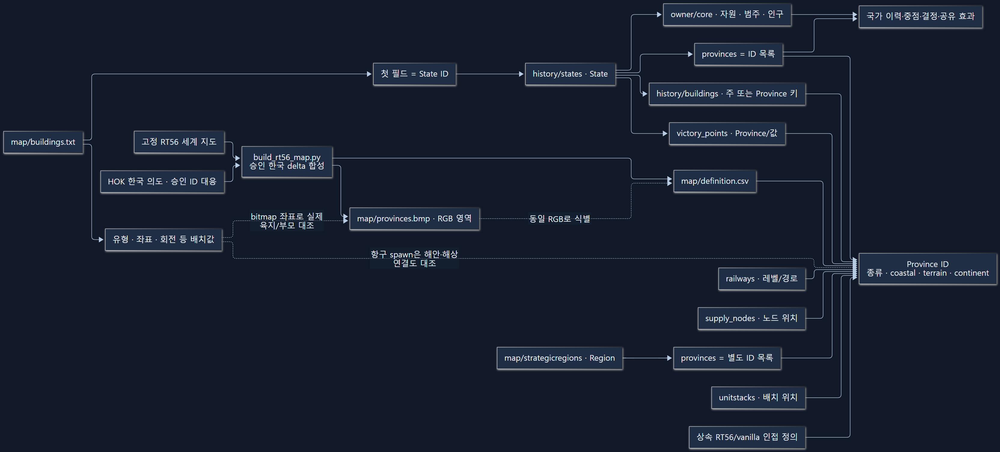
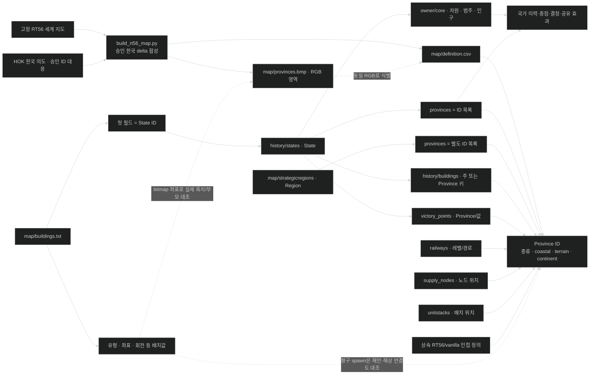
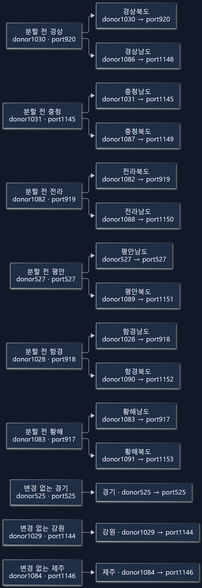
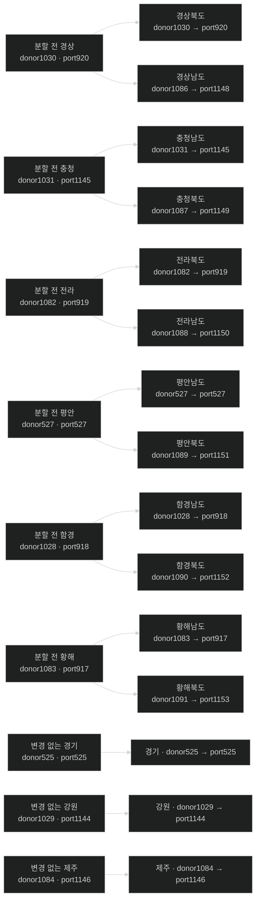
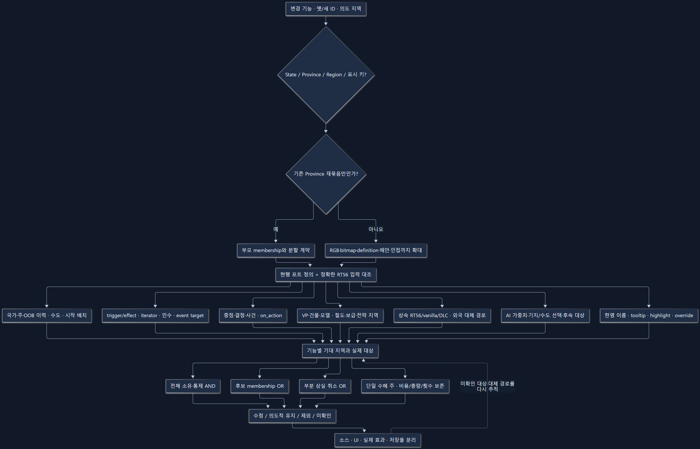
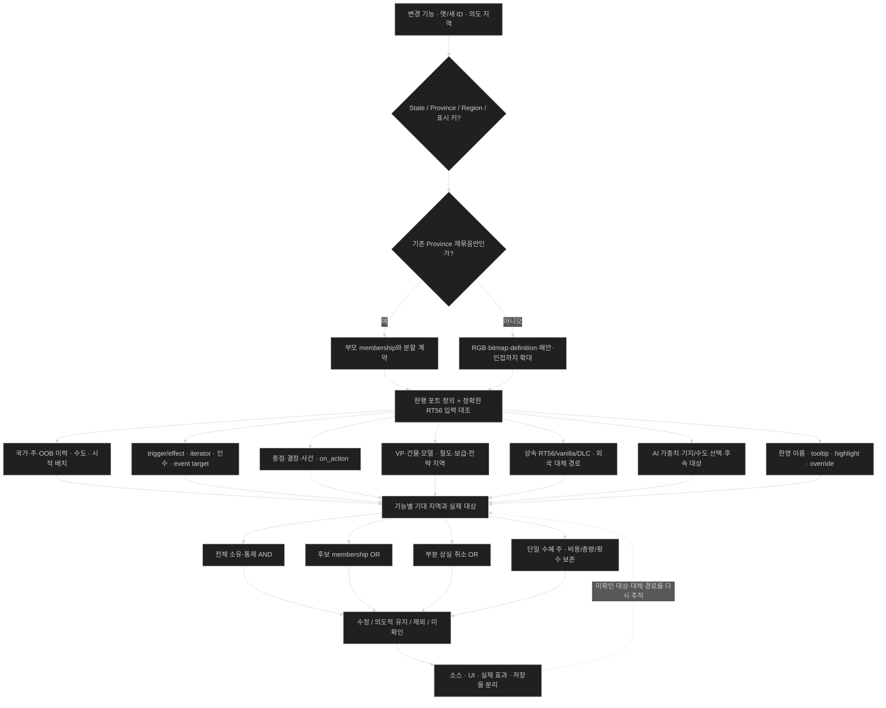

# 프로빈스 소속과 한국15주 대응

기준: **2026-11-20, Asia/Seoul**. 호환판 `9a01955785bcdd827c9c85522537a0bfc57ed654` 위 **현재 미커밋 통합 소스**를 읽은 설명이다. 이번 후속은 S04–S06의 상세화다. 지도·ID·보상·생성기는 변경하지 않았다. [이번 상세화 기록](../../implementation/2026-11-20-architecture-detail-expansion.md)과 [분할 구현 기록](../../implementation/2026-11-07-korean-state-split-port.md)의 과거 실행 범위를 구분한다.

[State 목차](README.md) · [정의와 scope](definition-and-scope.md) · [소유와 이전](ownership-and-transfer.md) · [변경 영향](change-impact.md) · [유지·갱신 안내](../maintenance.md)

지도 정본은 **RT56 세계 지도 + 승인된 HOK 변경**이다. State·Province·Strategic Region·표시 키는 서로 다른 식별 체계다. 다음 도표는 실제 데이터 연결과 승인된 한국 분할을 설명하며 전 세계 모든 주의 경계·해안·보급을 망라한 지도는 아니다.

## S04 · 서로 다른 지리 집합과 네트워크

실선은 파일이 가진 데이터·ID 참조, 점선은 좌표 해석 또는 별도 일치 확인이다. State와 Strategic Region은 각각 Province를 묶으며, State→Strategic Region이라는 단일 부모 계층이 아니다.

Mermaid 편집 원본

| 실제 자료 | 담는 것 | 독립적으로 대조할 점 |
|---|---|---|
| [definition](../../../map/definition.csv)·[bitmap](../../../map/provinces.bmp) | Province ID↔RGB와 지형 속성·색 영역 | 숫자 유효성과 실제 위치는 다르다. RT56 한국 외 색 영역을 보존한다. |
| [주 정의](../../../history/states/) | Province의 부모 State, 시작 데이터·날짜 이력 | [S02](definition-and-scope.md#s02-state-file-tree)처럼 Province별 건물과 주 건물을 구분한다. |
| [전략 지역186](../../../map/strategicregions/186-Korea.txt) | Province의 전략 지역 membership와 날씨 | 주 소속 목록과 독립된 목록이다. 번호186은 한국 State ID가 아니다. |
| [철도](../../../map/railways.txt)·[보급 노드](../../../map/supply_nodes.txt)·[unitstacks](../../../map/unitstacks.txt) | Province 경로·노드·배치 참조 | State를 나누었다고 경로 연결·실제 보급이 자동 확인되지는 않는다. |
| [모델 배치](../../../map/buildings.txt) | State ID, 건물 유형, 위치·회전 등 7필드 행 | 첫 필드만 맞아도 좌표의 실제 Province가 틀릴 수 있다. 건물 레벨 지급과 모델 위치는 별도다. |
| [지도 생성기](../../../tools/build_rt56_map.py)·[분할 계층](../../../tools/korean_state_split.py) | 고정 입력→합성 지도→분할 후속 출력 | 생성 출력만 수동으로 고치거나 donor 전체 지도를 복사하지 않는다. [D08/D20](../source-and-generation.md)을 따른다. |

[ADR-0002](../../decisions/0002-map-id-migration.md)의 Province13414–13447→13535–13568은 최초 충돌 회피 계약이다. [ADR-0006](../../decisions/0006-korean-state-split-integration.md)의 후속 분할은 기존 Province 집합 재배정이며 새 RGB·비트맵·해안선을 만들지 않았다. 이 두 작업을 같은 지도 변경으로 합치지 않는다. 최초 항구 spawn 7행 복원과 후속 경남 공군/로켓 위치 2행 복원도 각각의 제한된 근거를 가진다.

## S05 · 한국9→15주 전체 분할과 포트ID 대응

기존 앵커와 ID는 유지하되, 이제 그림은 **한국 9주→15주 전체 대응**을 표시한다. 실선은 분할 전 부모→현재 후속 주이며 영토 이전 명령이나 모든 세이브의 변환 경로가 아니다. 각 후속 노드의 donor→port 숫자는 현재 대응표의 State ID다.

Mermaid 편집 원본

| 부모 지역 | 현재 포트의 전체 후속 주와 실제 파일 | 표시 키 |
|---|---|---|
| 경상 | [경북920](../../../history/states/920-Gyeongsang.txt)·[경남1148](../../../history/states/1148-Gyeongsangnam.txt) | HOK_KOR_STATE_1030 / HOK_KOR_STATE_1086 |
| 충청 | [충남1145](../../../history/states/1145-Chungcheong.txt)·[충북1149](../../../history/states/1149-Chungcheongbuk.txt) | HOK_KOR_STATE_1031 / HOK_KOR_STATE_1087 |
| 전라 | [전북919](../../../history/states/919-Jeolla.txt)·[전남1150](../../../history/states/1150-Jeollanam.txt) | HOK_KOR_STATE_1082 / HOK_KOR_STATE_1088 |
| 평안 | [평남527](<../../../history/states/527-North Korea.txt>)·[평북1151](../../../history/states/1151-Pyeonganbuk.txt) | HOK_KOR_STATE_527 / HOK_KOR_STATE_1089 |
| 함경 | [함남918](../../../history/states/918-Hamgyong.txt)·[함북1152](../../../history/states/1152-Hamgyeongbuk.txt) | HOK_KOR_STATE_1028 / HOK_KOR_STATE_1090 |
| 황해 | [황남917](../../../history/states/917-Hwanghae.txt)·[황북1153](../../../history/states/1153-Hwanghaebuk.txt) | HOK_KOR_STATE_1083 / HOK_KOR_STATE_1091 |
| 경기 | [525](<../../../history/states/525-South Korea.txt>) | STATE_525 |
| 강원 | [1144](../../../history/states/1144-Gangwon.txt) | STATE_1144 |
| 제주 | [1146](../../../history/states/1146-Jeju.txt) | STATE_1146 |

기계 정본은 [포트 대응표](../../data/HOK_KOREAN_STATE_SPLIT_PORT_MAPPING.json)다. Province·인구·자원·건물·승점·날짜 이력의 세부 배분은 JSON에 남기고 그림에 재복제하지 않는다. 한영 12개 논리 키는 [한국어](../../../localisation/korean/HOK_KOR_state_split_l_korean.yml)·[영어](../../../localisation/english/HOK_KOR_state_split_l_english.yml)를 따른다. 키의 숫자를 포트 State ID에 맞춰 일괄 치환하지 않는다.

한국 전체15·북부6·남부9·제주 제외14는 서로 다른 집합이다. 함남918과 황남917은 북부다. 쓰시마1147과 나가사키528은 한국9→15 집계에 포함하지 않는다. 파일명 527-North Korea가 현재 평남의 전체 의미를 대신하지도 않는다.

초기 분할 계약은 인구25,899,038·시작 민공/군공/조선소9/4/1과 부모별 자원·고정 보상을 보존했다. 범주 슬롯 합33→57·기반시설 레벨 합14→23은 의도된 변화다. **현재 모든 보상 총량이 최초 분할 때와 같다는 주장도 아니다.** 후속 승인된 [11월10일 산업 업데이트](../../implementation/2026-11-10-korean-industry-update-port.md)는 별도의 보상 확대·남북 독립 사업 예외다. 옛 지도 저장을 자동 변환하지 않으며 새 게임 범위와 실제 저장 재로드 기록을 구분한다.

## S06 · 지역이 바뀔 때 따라갈 소비자

실선은 검토의 의존 관계, 점선은 재대조다. 모든 노드를 실행하는 테스트 절차가 아니다. 숫자 검색 뒤에 명령 종류·부모·지역 의도·동적 경로를 확인하며 실제 수정은 별도 승인 범위를 따른다.

Mermaid 편집 원본

| 기능별 접점 | 현재 의미와 처리 근거 |
|---|---|
| 옛 도 전체의 영토 조건 | 후속 주 AND, 후보 목록 확장은 OR, 일부 상실 취소는 실패 OR다. 기존 ROOT/subject/CONTROLLER 의미를 보존한다. [ADR-0006](../../decisions/0006-korean-state-split-integration.md)을 따른다. |
| 단일 보상·시설·수도 | 분할만으로 보상을 두 번 주지 않는다. 대구 State920/Province13557, 부산 State1148/Province4056처럼 명령 입력을 구분한다. 별도 승인 산업 변경은 해당 최신 기록을 읽는다. |
| 한국 해주·외국 수도·일본 후속 주 | [ADR-0007](../../decisions/0007-november-content-integration.md)의 해주13559→917, 난징11913→1114, 일본1105–1107 적응을 따른다. donor 난징1035가 포트에서도 올바른 지역이라고 가정하지 않는다. |
| 산둥 본토와 거점 | [별도 대응표](../../data/HOK_KOREAN_CHINESE_GOVERNMENT_RT56_MAPPING.json)의 64주·597/743과 [지리 기록](../../implementation/2026-11-20-chinese-government-state-mapping.md)을 읽는다. 한국15주와 다른 집합이며 donor63주 숫자를 그대로 복사하지 않는다. |
| 화면과 지역 의미 | 이름·파일명·키가 맞아도 실제 대상 지리의 증거가 아니다. [현지화 스킬](../../skills/hok-rt56-localisation-review/SKILL.md)의 활성 번역·동적 토큰 경로를 함께 따른다. |
| 생성 소유권 | 지도·분할·후속 콘텐츠의 입력/lock/writer를 구분한다. source pins나 과거 캡슐을 현재 출력에 맞춰 덮지 않는다. |

## 근거·누락 범위와 처리 대장

[변경 영향 절차](../../HOK_CHANGE_COVERAGE_REVIEW.md)와 [주 참조 스킬](../../skills/hok-rt56-state-reference-review/SKILL.md)을 적용한다. HOK 원본의 [지리 문서](../../../../hearts_of_korea/docs/architecture/states/geography-and-splits.md)는 설명 구조의 출처이며, 실제 포트 대응·지도 정의·최신 통합 기록이 여기의 대상 근거다.

| 기능·후보 | 처리 | 이번 확인과 남은 범위 |
|---|---|---|
| S04 데이터 집합·좌표·네트워크 | **수정** | State/Region 독립 집합과 모델 첫 필드·좌표 검사를 분리했다. 실제 보급·항구 화면을 새로 시험하지 않았다. |
| S05 전체9→15 및 표시 키 | **수정** | 6분할 부모·12후속과 변경 없는3주를 대응표·실제 파일·한영 키로 확인했다. 경계 폴리곤 지도나 수치 원장을 새로 만들지 않았다. |
| S06 호출자·분기·상속 참조 | **수정** | 현행 예외·지역 집합과 후보 처리 단계를 상세화했다. 모든 RT56 소비자의 전수 감사 결과는 아니다. |
| Province 이전·한국 밖 RT56·총량 정책 | **의도적 유지** | 지도·표시·생성기·보상을 편집하지 않았다. 최초 분할과 후속 산업 변경의 시점을 구분한다. |
| 새 ID·RGB·해안 변경·저장 변환 | **제외** | 도표 상세화에 필요하지 않으며 이번 승인 범위 밖이다. |
| 모든 경계·외부 로드 조합·동적 수혜국·기존9주 저장 | **미확인** | 숫자와 대표 소스 확인으로 전 세계 지리·실제 연결·모든 저장 호환을 보장하지 않는다. 기존 실행은 각 구현 기록에 한정한다. |

