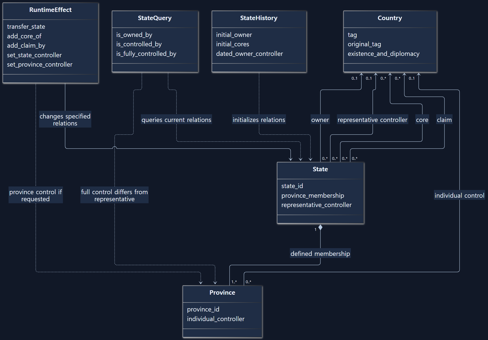
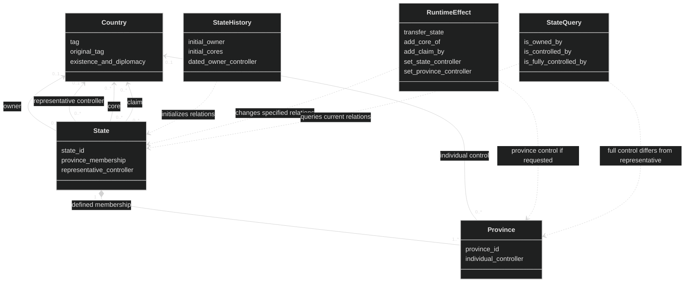
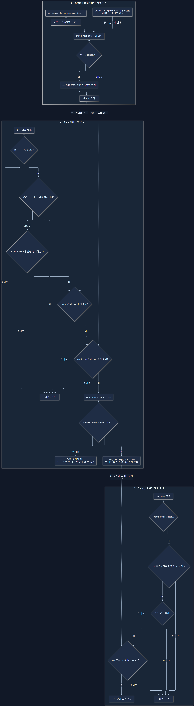
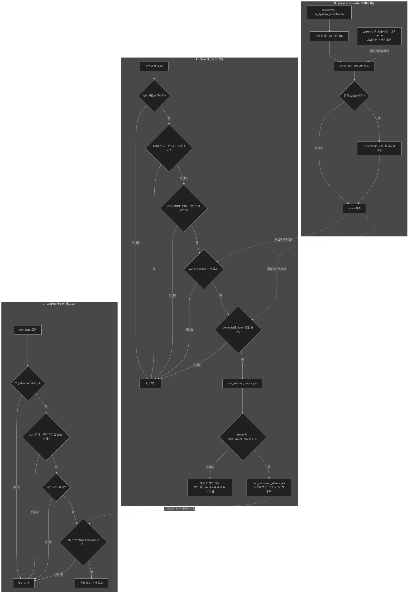
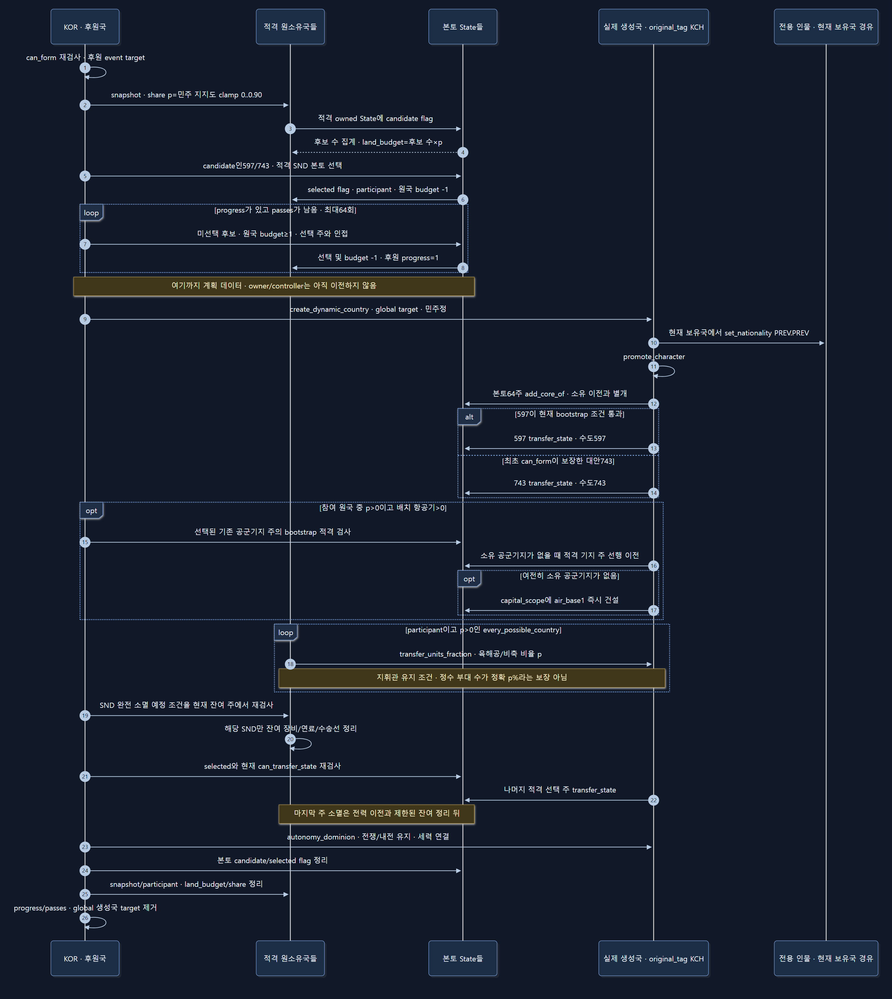
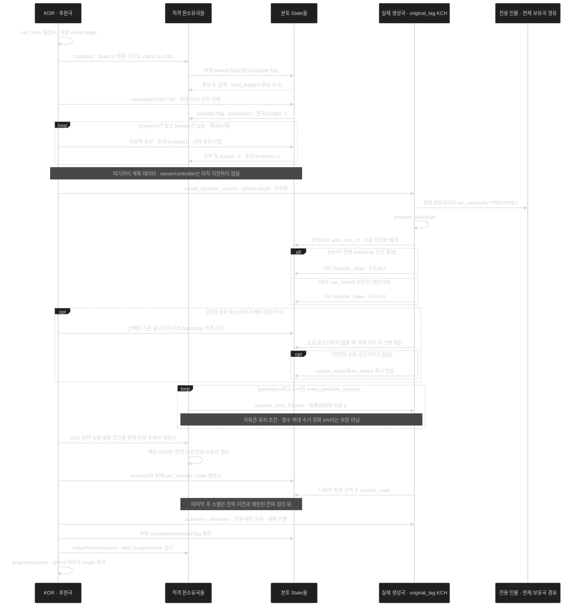

# 소유·통제·핵심주와 이전 순서

기준: **2026-11-20, Asia/Seoul**. 호환판 `9a01955785bcdd827c9c85522537a0bfc57ed654` 위 **현재 미커밋 통합 소스**를 읽은 설명이다. 이번 후속은 S07–S09의 상세화다. 실제 조건·전력·영토·생성기·설정은 변경하지 않았다. [이번 상세화 기록](../../implementation/2026-11-20-architecture-detail-expansion.md)과 [기존 콘텐츠 구현 기록](../../implementation/2026-11-20-korean-democratic-support-intelligence-port.md)의 실제 실행을 구분한다.

[State 목차](README.md) · [정의와 scope](definition-and-scope.md) · [지도와 분할](geography-and-splits.md) · [산둥 D15–D18](../shandong-government.md) · [유지·갱신 안내](../maintenance.md)

소유·대표 통제·완전 통제·개별 Province 점령·core/claim은 별개다. 이 문서는 현재 산둥 helper를 실제 사례로 삼되, 모든 영토 명령이나 전 세계 전쟁의 결과를 망라하지 않는다.

## S07 · 국가와 주의 서로 다른 관계

개념 classDiagram이다. 실선은 데이터 관계, 점선은 초기화·변경·조회다. 관계의 수는 **일반적인 의미를 설명하는 개념적 수량**이며 엔진 내부 클래스·실행 중 모든 예외 상태의 불변식을 복원한 것이 아니다. Province는 여기서 주에 포함되는 지리만 나타내며 모든 바다 Province까지 State 소속이라고 하지 않는다.

Mermaid 편집 원본

owner가 같은 주 집합과 controller가 같은 주 집합은 다를 수 있다. 대표 controller가 있어도 그 국가가 모든 Province를 통제한다고 추정하지 않는다. 반대로 core/claim은 현재 소유·점령의 증거가 아니다. 한 나라가 존재한다는 조건도 특정 주의 소유 조건과 별개다.

| 명령·조건 | 현재 scope와 입력 | 구분하는 계약 |
|---|---|---|
| history의 `owner=KOR`, 날짜 블록의 `controller=JAP` | 주 이력의 국가 태그 값 | 런타임의 `owner={...}`·`controller={...}` scope 진입과 다른 문법이다. |
| `transfer_state=597` | **Country**, 입력 State | 해당 주의 owner와 controller를 설정하는 명령이다. 코어 부여 명령으로 대체하지 않는다. |
| `add_core_of=PREV` / `add_claim_by=TAG` | **State**, 입력 Country | 각각 코어·클레임 관계를 추가한다. 영토 소유나 완전 통제를 지급하지 않는다. |
| `set_state_controller=ID` | **Country**, 입력 State | 통제를 바꾸는 명령이며 소유권 이전과 분리한다. |
| `set_province_controller=ID` | **Country**, 입력 Province | Province 단위 통제다. State ID와 혼동하지 않는다. |
| `is_owned_by=ROOT` | **State**, 대상 Country | 현재 소유자를 검사한다. |
| `is_controlled_by=KOR` | **State**, 대상 Country | 대표 통제 검사다. 완전 통제와 별도다. |
| `is_fully_controlled_by=CONTROLLER` | **State**, 대상 Country | 산둥 helper는 혼합 통제를 배제하기 위해 이 조건을 추가로 쓴다. |
| `country_exists=KCH`, Country의 `exists=yes` | 국가 존재 문맥 | 특정 주의 owner/controller/core/claim을 대신 검사하지 않는다. |

scope·명령 의미의 설치 원본 근거는 `C:/Program Files (x86)/Steam/steamapps/common/Hearts of Iron IV/documentation/effects_documentation.md`의 add_core_of/add_claim_by/transfer_state/set_state_controller/set_province_controller와 `triggers_documentation.md`의 위 세 State 조회 항목이다. 읽은 설치 메타데이터는 `Operation Postern v1.20.0.0.8873 (0c4f)`다. 공식 명령 설명·포트의 실제 호출·엔진 실행 관측은 서로 다른 증거다.

history나 네이티브 저장에서 controller가 생략됐다는 사실만으로 owner와 같다고 보충하지 않는다. 위 transfer_state 계약도 모든 history·저장 생략 필드의 기본값을 입증하는 근거로 일반화하지 않는다.

## S08 · 이전 적격과 안전한 첫 거점

State의 **차단 / 일반 이전만 가능 / 첫 거점 가능**을 나누고, 별도 Country 출범 조건과 연결한다. 화살표는 조건의 의존 관계다. 실제 엔진의 평가·단락 순서를 복원한 것이 아니다. 그림의 짧은 이름은 모두 아래 표의 실제 helper를 뜻한다.

Mermaid 편집 원본

| 실제 정의·호출부 | 정확한 범위와 예외 |
|---|---|
| [is_mainland / can_transfer_state](../../../common/scripted_triggers/HOK_KOR_chinese_government_state_triggers.txt) | [RT56 대응표](../../data/HOK_KOREAN_CHINESE_GOVERNMENT_RT56_MAPPING.json)의 본토64주다. 만주·섬·외국 조계 등을 임의 확장하지 않는다. KOR 소유/통제를 보호하고 혼합 통제를 배제한다. |
| [is_donor와 정식16태그](../../../common/scripted_triggers/HOK_KOR_chinese_democratic_support_triggers.txt) | CHI·PRC·SHX·GXC·YUN·XSM·SIK·GDC·SND·SIC·NXM·GSM·XIC·KHM·KUM·HBC 중 실존 비동적 국가다. 여기에 직접·2단계 일본 종속 제외가 붙는다. 독립국에서 불필요한 overlord scope를 열지 않는다. |
| owner와 controller | 서로 같아야 한다는 조건은 없다. 완전 통제 및 양쪽의 적격을 각각 검사한다. 예산과 지지도는 **원소유국**에서 계산한다. |
| can_bootstrap_state | owner의 전체 소유 주 수가 **1보다 큼**이다. 적격 본토 주 수·점령 주 수·controller의 소유 주 수로 바꾸지 않는다. 마지막 주의 일반 이전까지 영구 금지하는 조건도 아니다. |
| can_form / has_chi_democracy | TfV·CHI 존재·민주50% 이상·KCH 부재·597/743 중 안전한 거점을 함께 요구한다. CHI의50%를 모든 donor에게 요구하지 않는다. |
| [한국 중점](../../../common/national_focus/korea.txt)의 진입·유지 | 한국 민주/독립·대표국 등 추가 조건, 70일과 취소 경로는 [D15](../shandong-government.md#d15-call-and-shared-guards)를 따른다. 공유 helper 통과만으로 모든 중점 조건을 충족하지 않는다. |
| SND 기본 영토 | 후보로 적격인 SND 소유 본토를 전부 선택하는 후속 규칙이다. 한국 보호·혼합 통제·일본 종속 배제를 우회하지 않는다. |

거점은 RT56 산둥597·칭다오743이며 실제 RT56 지리와 [매핑 기록](../../implementation/2026-11-20-chinese-government-state-mapping.md)을 따른다. 1117 제남은 같은 광역 지역의 별도 주이지 두 거점 중 하나로 새로 추가된 번호가 아니다. 실제 보호/743 대안 사례는 콘텐츠 구현 기록에 있으나 이 도표 작성에서 다시 실행하지 않았다.

## S09 · 선택 표식과 실제 영토 이전

실제 [출범 효과](../../../common/scripted_effects/HOK_KOR_chinese_government_effects.txt)의 주요 순서를 sequenceDiagram으로 표시한다. 실선 메시지는 호출·변경, 점선 응답은 조회·참조이며 엔진의 비동기 큐나 원자적 트랜잭션을 뜻하지 않는다. 생성국은 `original_tag=KCH`인 동적 국가다. 실제 tag를 D08 등으로 고정하지 않는다.

Mermaid 편집 원본

| 단계·보존 계약 | 소스에서 구분할 점 |
|---|---|
| p와 토지 예산 | 산둥 p는0–90%다. 일본 봉기의10–90%와 다르다. 후보 수×p에서 기본 거점·적격 SND 선택도1씩 차감하므로 이 선택을 예산에 맞춘 무작위 비율 배분이라고 설명하지 않는다. |
| 연속 선택 | State의 인접 selected flag가 기준이다. 현재 소유권 변경 뒤 새 국경을 따라가는 과정이 아니다. 반복 상한64와 더 이상 진전 없음이 종료 조건이다. |
| 코어·첫 이전·수도 | 코어는 본토 전체에 별도 부여한다. 597 bootstrap을 생성 문맥에서 다시 검사한 뒤 대안743을 사용한다. 코드에 없는 별도의743 재검사 단계를 도표에 추가하지 않는다. |
| 항공기 수용 | 참여 원국의 양수 p·배치 항공기를 확인한 경우에만 선행 기지 확보를 시도한다. 선택된 기존 기지 주도 bootstrap을 통과해야 한다. 없으면 생성국 수도에1레벨만 만든다. |
| 전력·비축 | size/army_ratio/stockpile_ratio/navy_ratio/air_ratio가 같은 p이고0이면 해당 이전을 건너뛴다. keep_unit_leaders_trigger는 지휘관 유지다. 전용 웡원하오 이동과 일반 지휘관 귀순을 혼동하지 않는다. |
| SND 소멸 잔여 | 모든 남은 소유 주가 selected이면서 현재 이전 가능할 때의 SND만 대상이다. 일반 중국 donor 전체의 잔여 장비를 삭제하는 규칙이 아니다. 실제 연료 수치의 미세 차이는 기존 기록의 미확인으로 남긴다. |
| 마지막 영토 이전 | 이전된 거점은 이미 동적 국가 소유여서 더 이상 정식 donor가 아니다. 나머지 selected를 현재 조건으로 다시 거른다. 표식만으로 보호 조건을 무시하지 않는다. |
| 자치·세력·인정 | helper는 새 전쟁을 선언하지 않고 자치 설정에서 전쟁·내전을 종료하지 않는다. 중점의 별도 전쟁목표 지급과 인정 결정의 CHI 한정 annex는 이 시퀀스 밖이다. 실제 중국 비맹주 사례는 전체 과정 성공이며 자치 설정/명시적 초대 중 어느 명령이 가입을 수행했는지는 분리하지 않았다. |
| 정리·재호출 | 주 표식, 소멸 원국도 포함하는 every_possible_country의 임시 국가 표식·변수, 후원 반복 변수·global target을 지운다. 기존 KCH 부재 guard와 실제 재호출 무변화는 각각 소스/기존 실행 증거다. |

## 근거·누락 범위와 처리 대장

[상태 조건](../../../common/scripted_triggers/HOK_KOR_chinese_government_state_triggers.txt), [정식 donor 집합](../../../common/scripted_triggers/HOK_KOR_chinese_democratic_support_triggers.txt), [출범 효과](../../../common/scripted_effects/HOK_KOR_chinese_government_effects.txt), [본토 대응표](../../data/HOK_KOREAN_CHINESE_GOVERNMENT_RT56_MAPPING.json), [D15–D18](../shandong-government.md)을 함께 읽는다. HOK 원본의 [소유 문서](../../../../hearts_of_korea/docs/architecture/states/ownership-and-transfer.md)는 관계·단계 분리의 출처다. 실제 포트의64주·RT56 거점·현재 호출자가 이 문서의 근거다.

| 기능·후보 | 처리 | 이번 확인과 남은 범위 |
|---|---|---|
| S07 관계·명령·조회 scope | **수정** | 개념 classDiagram과 실제 설치 명령 계약을 상세화했다. 엔진 클래스·생략 controller 기본값은 추정하지 않았다. |
| S08 차단·일반·bootstrap·can_form | **수정** | 실제 caller와 정식16태그·본토64주·보호/종속 조건·엄격 비교를 분리했다. |
| S09 계획·전력·마지막 영토·정리 | **수정** | sequenceDiagram과 대안 기지·SND 정리·재검사·동적 scope를 설명했다. 실제 실행 순서의 타이밍/동시성 보장은 아니다. |
| 기존 지도·정치 조건·비율·자치·캐릭터 ID | **의도적 유지** | 문서만 변경했다. 중국 helper·일본 helper·잠금·런타임 출력을 수정하지 않았다. |
| 일반 세계의 모든 관계·새 합병·지도 이전·게임 실행 | **제외** | 이번 승인 범위 밖이다. |
| 모든 전선·원국 조합·동적 태그·장기/MP·이전 저장 | **미확인** | 소스의 경로와 기존에 관측한 bounded 사례를 구분한다. 정수 전력의 정확 백분율·일반 지휘관 귀순·모든 DLC 조합을 주장하지 않는다. |

[변경 영향 절차](../../HOK_CHANGE_COVERAGE_REVIEW.md) · [주 참조 스킬](../../skills/hok-rt56-state-reference-review/SKILL.md)

